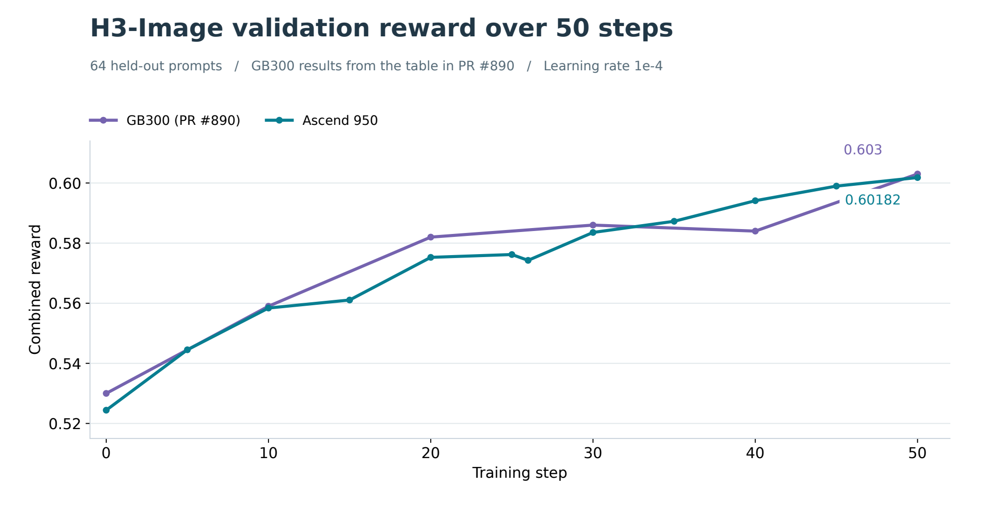
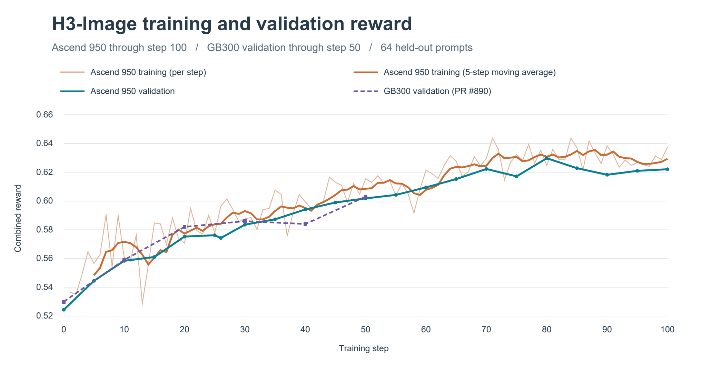
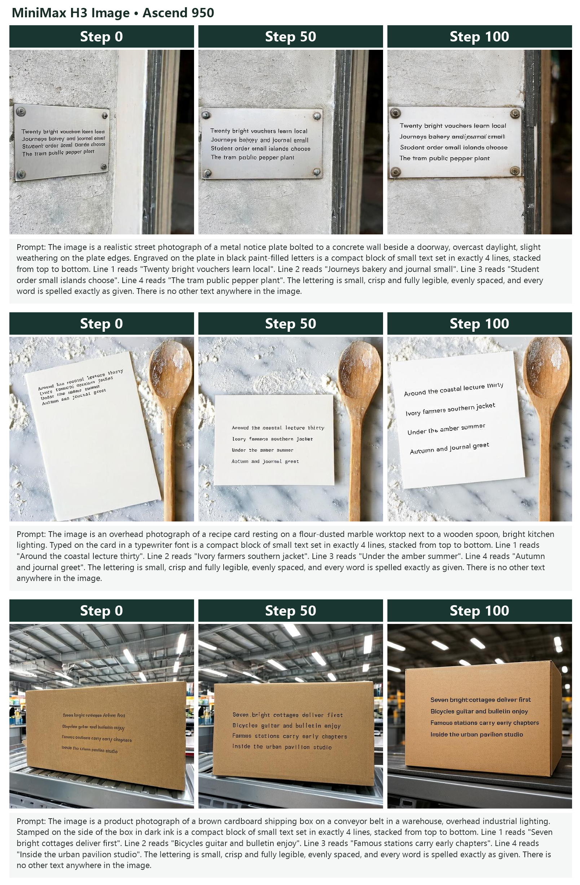

# MiniMax H3 Image DiffusionNFT LoRA on Ascend 950

Run DiffusionNFT LoRA training for MiniMax H3 Image on a single eight-NPU Ascend 950DT node. The recipe trains a six-step PDD sampler to render dense text. On 64 held-out prompts, mean validation reward increased from 0.52441 at initialization to 0.60182 at step 50. We extended training to 100 steps, reaching a mean validation reward of 0.62208. These results demonstrate that the Ascend 950 implementation supports end-to-end DiffusionNFT LoRA training for MiniMax H3 Image.

The implementation, including the H3 Image Actor, native vLLM-Omni rollout, checkpoint converter and Ascend execution paths, is submitted in [verl-omni PR #897](https://github.com/verl-project/verl-omni/pull/897). This recipe pins that contribution to commit `92a3ff23ad7c5ea1724fca1fb025a2d3c3cf35bf` for reproduction.

## Required verl version and environment

The core verl pin is recorded in [REQUIRED_VERL.txt](REQUIRED_VERL.txt). Prepare an Ascend environment with the following runtime and source revisions. The source revisions below identify the runtime used for the experiment.

| Component | Version or revision |
| --- | --- |
| Hardware | One node, 8 × Ascend 950DT, 96 GiB HBM per NPU |
| Python | 3.12 |
| PyTorch | 2.10.0+cpu |
| torch-npu | 2.10.0.post7 |
| CANN | 9.2.0 |
| Diffusers | 0.41.0 with the image-packing patch described below |
| Transformers | 5.19.0 |
| vLLM | `4ba787ec` |
| vLLM-Ascend | `760d7ecb` |
| vLLM-Omni | `eb8b991f` |
| verl | `fefb080262e1c015a0ea05f958822a6a512dc795` |
| verl-omni | `92a3ff23ad7c5ea1724fca1fb025a2d3c3cf35bf` |

Load the node's driver, CANN and ATB runtime libraries before activating the prepared training environment. See the repository's [Ascend 950 installation guide](../get_start/install_guidance_A5.rst) for the platform setup. Install the vLLM, vLLM-Ascend and vLLM-Omni revisions above with their Ascend build instructions and dependencies before installing the pinned verl-omni source. Its declared GPU dependencies require explicit version overrides for this Ascend runtime, so install the checkout with `--no-deps` after preparing those dependencies.

```bash
git clone \
    https://github.com/Li-Jicheng/verl-omni.git \
    /path/to/verl-omni
export VERL_OMNI_PATH=/path/to/verl-omni
git -C "$VERL_OMNI_PATH" checkout \
    92a3ff23ad7c5ea1724fca1fb025a2d3c3cf35bf
pip install \
    --no-deps \
    -e "$VERL_OMNI_PATH"
```

Install the reward-side dependencies `rapidocr`, `onnxruntime` and `open_clip_torch` in that environment. RapidOCR must expose `OCRVersion.PPOCRV6`.

### Diffusers image-packing patch

This pinned recipe loads `MiniMaxH3Transformer3DModel` from Diffusers 0.41.0. On the tested Ascend runtime, its out-of-place `index_copy` with empty audio indices can corrupt the packed text/image input. Apply the patch supplied by the pinned implementation before training. The reverse check makes this command safe to repeat on an already patched environment.

```bash
diffusers_parent=$(python -c 'import diffusers; from pathlib import Path; print(Path(diffusers.__file__).resolve().parents[1])')
packing_patch="$VERL_OMNI_PATH/examples/diffusionnft_trainer/minimax_h3_image/patches/diffusers-0.41.0-npu-empty-audio.patch"
if patch \
    -d "$diffusers_parent" \
    -p1 \
    --reverse \
    --dry-run \
    -i "$packing_patch"; then
    echo "Diffusers image-packing patch is already applied."
else
    patch \
        -d "$diffusers_parent" \
        -p1 \
        --forward \
        -i "$packing_patch"
fi
```

## Weights and data

Set the following paths for the native MiniMax H3 Image release and the reward models. `MODEL_PATH` must contain the native `transformer/`, `vae/`, `tokenizer/`, `pdd_config.json` and `pdd_fused_heads.safetensors`. `ACTOR_PATH` is the output directory for the Diffusers-layout Actor conversion.

```bash
export MODEL_PATH=/path/to/MiniMax-H3-Image
export ACTOR_PATH=/path/to/h3-image-diffusers-actor
export DATA_DIR=/path/to/h3-image-dense-text
export REWARD_MODEL_NAME=/path/to/Qwen3-VL-8B-Instruct
export PICKSCORE_PATH=/path/to/PickScore_v1
export CLIP_H14_PATH=/path/to/CLIP-ViT-H-14-laion2B-s32B-b79K
export CUSTOM_REWARD_MODEL_PATH=/path/to/HPS_v2.1_compressed.pt
export PPOCR_MODEL_DIR=/path/to/ppocrv6
```

`CLIP_H14_PATH` must contain `open_clip_pytorch_model.bin`. `PPOCR_MODEL_DIR` must contain `PP-OCRv6_det_medium.onnx` and `PP-OCRv6_rec_medium.onnx`. The reward assets are [PickScore](https://huggingface.co/yuvalkirstain/PickScore_v1), [CLIP ViT-H/14](https://huggingface.co/laion/CLIP-ViT-H-14-laion2B-s32B-b79K), [HPSv2.1](https://huggingface.co/xswu/HPSv2) and [Qwen3-VL-8B-Instruct](https://huggingface.co/Qwen/Qwen3-VL-8B-Instruct). Download the [native H3 Image release](https://huggingface.co/MiniMaxAI/MiniMax-H3-Image) and prepare the Actor and data with the pinned implementation.

```bash
python "$VERL_OMNI_PATH/examples/diffusionnft_trainer/minimax_h3_image/prepare_dense_text_data.py" \
    --output-dir "$DATA_DIR"
python "$VERL_OMNI_PATH/verl_omni/pipelines/minimax_h3_image_diffusion_nft/checkpoint.py" \
    convert \
    --native-root "$MODEL_PATH" \
    --output "$ACTOR_PATH"
```

The data preparation produces `train_t20.parquet` and `test_t20.parquet`. Ground-truth text and the prompt lookup keys are carried in the data rows for reward evaluation.

## Training

From the root of this recipe repository, launch on an allocation containing all eight NPUs. The default runs 100 steps from the base model with validation before training and every five steps, and writes TensorBoard events under `OUTPUT_DIR/tensorboard`.

```bash
export OUTPUT_DIR=/path/to/output/h3-image-ascend950-100steps
bash Ascend_950/minimax_h3_image/run_8npu.sh
```

Set `TOTAL_TRAINING_STEPS=1` for a one-step smoke run. Trailing Hydra arguments are forwarded to the pinned launcher. Checkpoint saving defaults to disabled, and can be enabled with `trainer.save_freq=50`.

| Setting | Value |
| --- | --- |
| Actor | FSDP2, four ranks on NPUs 0–3 |
| Rollout | Two TP2 replicas colocated on NPUs 0–3, text encoder TP2 |
| OCR reward | Three Qwen3-VL replicas on NPUs 4–6 |
| Preference reward | PickScore and HPSv2.1 on NPU 7 |
| Memory settings | Actor parameter/optimizer CPU offload, gradient checkpointing, microbatch size 1 |
| Sampling | 12 prompts × 8 images per training step, 512 × 512, six PDD steps, CFG 1 |
| Optimizer | Learning rate `1e-4` |
| LoRA | Rank 66, alpha 132 |
| Validation | 64 held-out prompts, seed 42, before training and every 5 steps |
| Logging | Console and TensorBoard |

## Reward setting

Combined reward is `0.5 × PickScore + 0.2 × guarded OCR + 0.3 × HPSv2.1`.

PickScore is normalized by dividing its logit by 26. OCR is evaluated with Qwen3-VL at temperature 0 with up to 160 response tokens. The layout guard is zero if a PP-OCR text box touches the image border within 2 pixels, otherwise it is `min(1, 0.08 / text_area)`. Guarded OCR multiplies the raw OCR score by this guard. The reward protocol follows the [published GPU recipe](https://github.com/aoshen02/verl-omni/blob/5216577fa6524e235967537a5cba39153e4670b8/examples/diffusionnft_trainer/minimax_h3_image/README.md).

## Results

Both training and validation rewards on Ascend 950 showed a healthy upward trend over 100 steps. Mean training reward rose from 0.54835 over steps 1–5 to 0.62939 over steps 96–100.

| Platform | Training step | Mean validation reward |
| --- | ---: | ---: |
| Ascend 950 | 0 | 0.52441 |
| Ascend 950 | 50 | 0.60182 |
| GB300 | 50 | 0.603 |
| Ascend 950 | 100 | 0.62208 |



At step 50, each row below averages 64 generated images. Text area and border touch are fractions.

| Platform | Reward | Guarded OCR | Raw OCR | PickScore | HPSv2.1 | Text area | Border touch |
| --- | ---: | ---: | ---: | ---: | ---: | ---: | ---: |
| Ascend 950 | 0.60182 | 0.76868 | 0.90465 | 0.76870 | 0.21244 | 0.08970 | 0.01562 |
| GB300 | 0.603 | 0.794 | 0.848 | 0.765 | 0.201 | 0.078 | 0.000 |



The following held-out examples show generation at steps 0, 50 and 100. Each row includes its complete original prompt.



## Implementation and verification

The pinned verl-omni contribution contains FP32 lookup of the six PDD timesteps on NPU, BF16 NPU Actor execution, RMSNorm dispatch through `torch_npu.npu_rms_norm`, device assignment for preference-scoring subprocesses, and the Diffusers image-packing fix. The H3 Image converter, adapters and dense-text reward recipe derive from aoshen524's commits `46ebe8a`, `b5dd965` and `5216577`. [Original shared implementation](https://github.com/aoshen02/verl-omni/blob/5216577fa6524e235967537a5cba39153e4670b8/verl_omni/pipelines/minimax_h3_image_diffusion_nft/diffusers_training_adapter.py)

The experimental source passed 14 NPU regression cases. Its main-based contribution passed 51 CPU pipeline tests. The plots report the Ascend experiment's first 100 training steps. Recipe-level launcher checks cover Bash syntax, argument forwarding, the default 100-step limit, and invocation from a working directory outside the verl-omni checkout.
