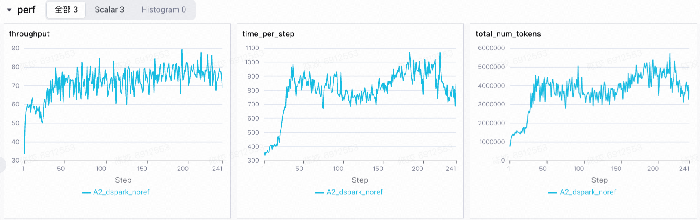
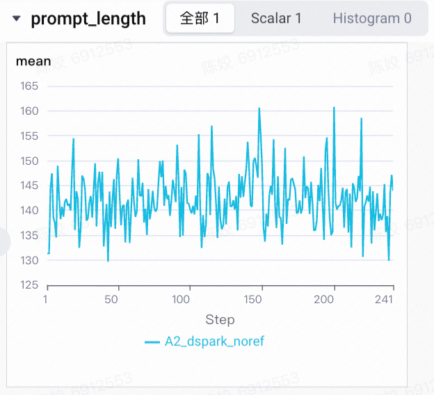
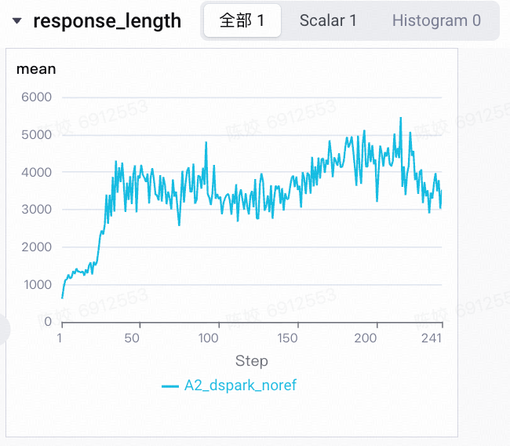
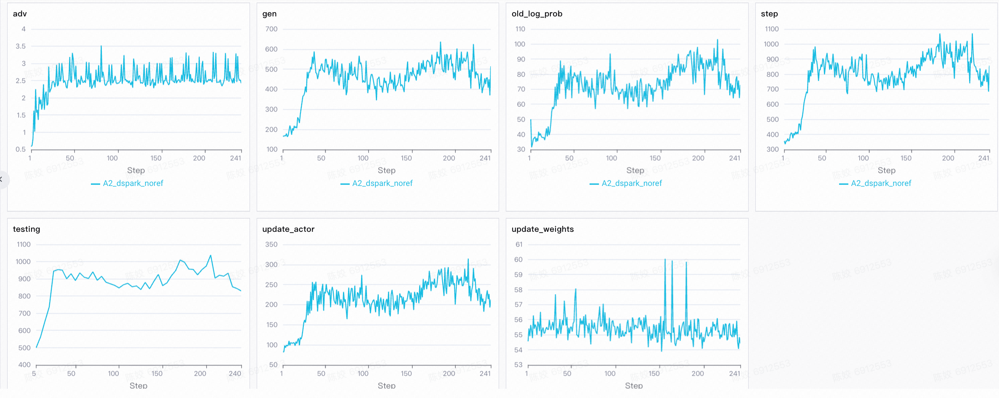
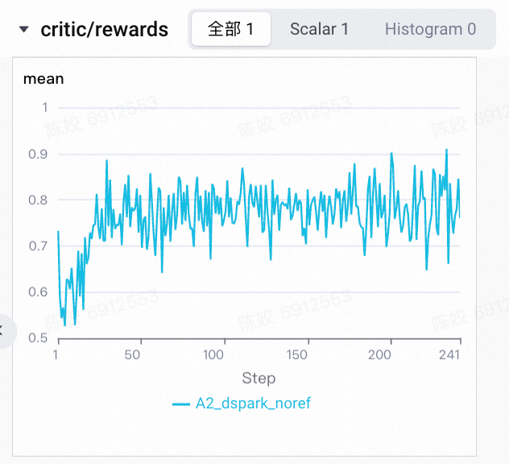
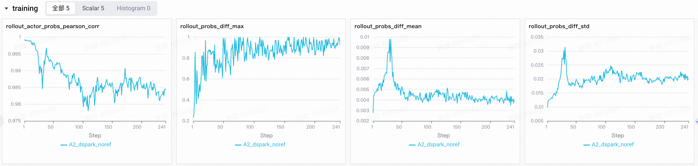
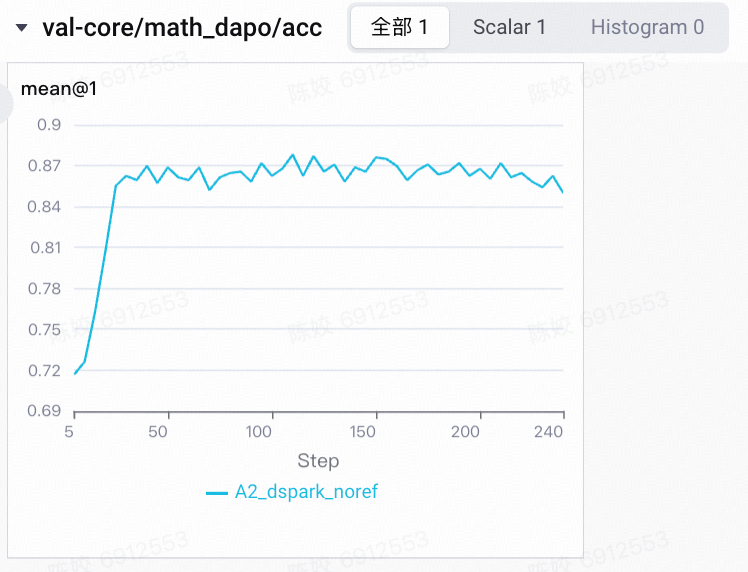
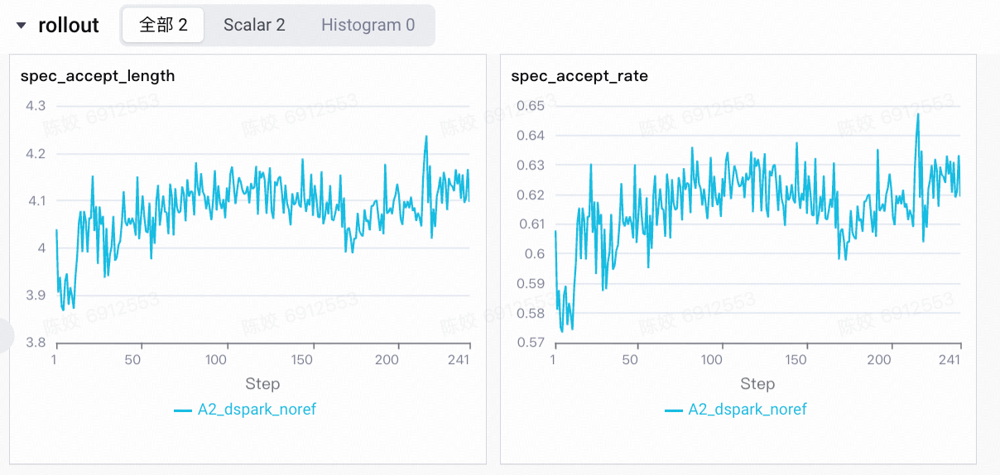

# DeepSeek-V4-Flash on Atlas A3

本目录提供 DeepSeek-V4-Flash 在 Atlas A3 上进行 RLHF 后训练所需的源码补丁和安装入口。当前补丁基于 `code/` 下已验证的七个源码仓库整理，共 37 个，详细功能和应用顺序见 [patch-read.md](./patch-read.md)。

## 环境版本

基础运行环境沿用 DeepSeek-V4-Flash 样例：

| 依赖组件 | 版本 / commit |
| --- | --- |
| CANN | 9.1.0 |
| PyTorch | 2.10.0 |
| torch_npu | 2.10.0.post4 |
| Python | 3.12 |
| vLLM | `v0.30.0` / `ced6857afa0ea7b2e3f0846a62e1394e90f15607` |
| vLLM-Ascend | `releases/v0.30.0` / `2df8721f4ed5d581136d7a5e3dd2487ef5036899` |
| mbridge | `v0.15.1` / `0cd4ae23f2425da77a80cb3f517828452fa8e984` |
| verl | `release/v0.9.0` / `91c297dc8d9991b79c90cad5b50683a5d6d8c02b` |
| MindSpeed | `26.2.0_core_r0.12.1` / `15023c2d0fed38d17f01b5fa7baf4ede63e0dd4e` |
| Megatron-LM | `core_v0.12.1` / `a845aa7e12b3a117e24c2352b9e3e60bad2e3a17` |
| MindSpeed-LLM | `26.2.0` / `e4a75c1faa05637496133e1e8ff7c78451fe92e2` |
| Transformers | 5.14.1 |

## 环境部署

在用于保存七个源码仓库的父目录中执行：

```bash
bash /path/to/verl-ascend-recipe/DeepSeek-V4-Flash/patch/A3/install.sh
```

[install.sh](./install.sh) 会克隆并固定上表 commit，安装依赖，然后按编号应用各仓库补丁。每份补丁在应用前都会执行 `git apply --check`，任何一步失败都会立即停止。

## 权重下载与反量化

1. 从 [Hugging Face](https://huggingface.co/deepseek-ai/DeepSeek-V4-Flash-Base) 下载 DeepSeek-V4-Flash-Base 权重和配置。
2. 使用 MindSpeed-LLM 提供的脚本将 FP8 mixed 权重反量化为 BF16：

   ```bash
   cd MindSpeed-LLM
   bash examples/mcore/deepseek4_flash/ckpt_dequant_deepseek4_fp8_to_bf16.sh
   ```

3. 如需使用减层模型，请同步修改权重目录中 `config.json` 的 `num_hidden_layers`。

## 启动训练

启动脚本和实际数据、权重、集群路径将在后续补充。

```bash
```

## 训练效果


### 性能结果

#### 吞吐量、单步耗时与 token 数



#### 平均 prompt 长度



#### 平均 response 长度



#### 训练各阶段耗时



### Rewards




### 训推一致性



### 验证集准确率



### DSpark 接受长度与接受率


