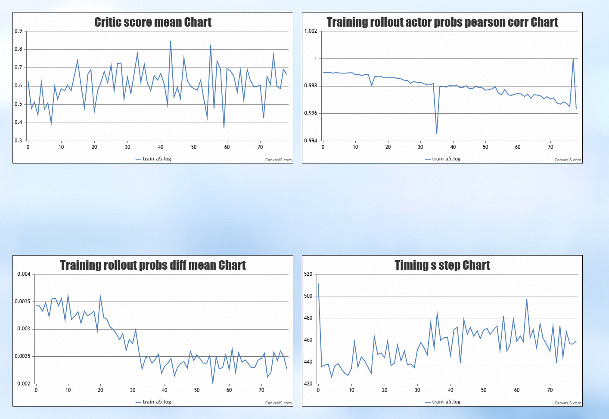
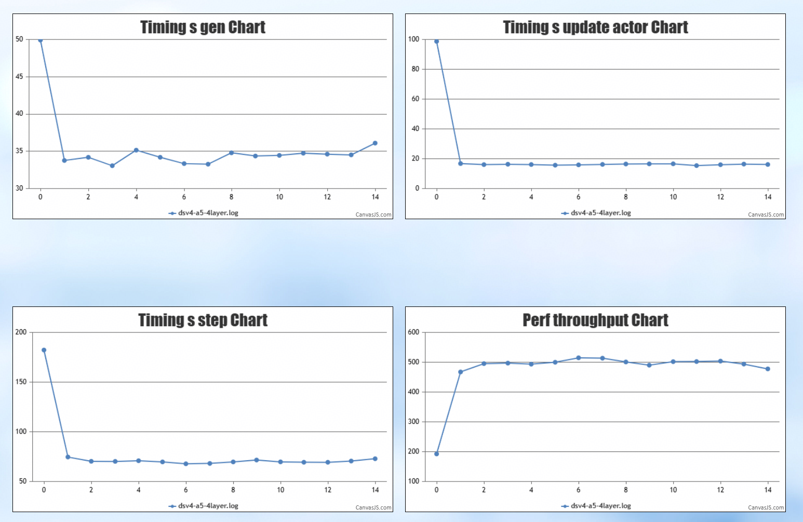

# DeepSeek-V4 on Ascend NPU
基于DeepSeek-V4-Flash模型在NPU上进行RLHF后训练的样例。

本用例基于 8 x Atlas A5 实现， 开发者可以参照调整。

## 环境版本
由于当前部分组件依赖尚未发布正式版本，我们将提供用于快速复现的基础镜像及部署方法，获取参照环境部署章节，主要依赖版本如下
后续会更新正式版本

| 依赖组件                | 版本            | 
| :--------------------- | :------         | 
| CANN                   | 9.2.0           | 
| PyTorch                | 2.10.0          | 
| torch\_npu             | 2.10.0.post4    | 
| verl                   | 809f2d8         | 
| vLLM                   | v0.27.1         | 
| vLLM-Ascend            | 343743a (master)| 
| MindSpeed-LLM          | a83d51e (master)| 
| MindSpeed              | 4fb7dc0 (master)| 
| Megatron               | core_v0.12.1    | 


### 环境部署
我们基于VLLM+MindSpeed-LLM后端在A5上支持DeepSeekV4的强化学习

```bash

conda create -n verl-npu python=3.12 -y
conda activate verl-npu

# 获取环境依赖
git clone https://github.com/verl-project/verl-ascend-recipe.git

# 首先根据实际cann的安装路径source cann
CANN_INSTALL_PATH=${CANN_INSTALL_PATH:-"/usr/local/Ascend"}
source ${CANN_INSTALL_PATH}/cann/set_env.sh

# 然后执行安装步骤
bash verl-ascend-recipe/DeepSeek-V4-Flash/install_A5.sh

# 创建软链接
cd verl
ln -s ../MindSpeed/mindspeed mindspeed
ln -s ../MindSpeed-LLM/mindspeed_llm mindspeed_llm
ln -s ../Megatron-LM/megatron megatron
ln -s ../mbridge/mbridge mbridge
```

#### 镜像安装说明

如使用镜像安装上述环境，在安装完之后请执行以下内容

首先根据实际cann的安装路径source cann

```bash

CANN_INSTALL_PATH=${CANN_INSTALL_PATH:-"/usr/local/Ascend"}
source ${CANN_INSTALL_PATH}/cann/set_env.sh

```

然后执行如下安装内容

```bash

ARCH=$(uname -m)
echo "Install memfabric_hybrid based on architecture..."
MEMFABRIC_VERSION=1.3.0
MEMFABRIC_DATE=20260921.3
MEMCACHE_VERSION=1.3.0
MEMCACHE_DATE=20260921.3
if [ "$ARCH" = "x86_64" ]; then
    MEMFABRIC_URL="https://obs-memfabric-hybrid.obs.cn-north-4.myhuaweicloud.com/mf/master/${MEMFABRIC_DATE}/memfabric_hybrid-${MEMFABRIC_VERSION}-cp312-cp312-manylinux_2_27_x86_64.manylinux_2_28_x86_64.whl"
else
    MEMFABRIC_URL="https://obs-memfabric-hybrid.obs.cn-north-4.myhuaweicloud.com/mf/master/${MEMFABRIC_DATE}/memfabric_hybrid-${MEMFABRIC_VERSION}-cp312-cp312-manylinux_2_26_aarch64.manylinux_2_28_aarch64.whl"
fi
python3 -m pip install "$MEMFABRIC_URL" --force-reinstall --no-deps  --trusted-host obs-memfabric-hybrid.obs.cn-north-4.myhuaweicloud.com

# ---- full mode ----
# ---- memcache_hybrid ----
echo "Install memcache_hybrid based on architecture..."
if [ "$ARCH" = "x86_64" ]; then
    MEMCACHE_URL="https://obs-memfabric-hybrid.obs.cn-north-4.myhuaweicloud.com/memcache/master/${MEMCACHE_DATE}/memcache_hybrid-${MEMCACHE_VERSION}-cp312-cp312-manylinux_2_27_x86_64.manylinux_2_28_x86_64.whl"
else
    MEMCACHE_URL="https://obs-memfabric-hybrid.obs.cn-north-4.myhuaweicloud.com/memcache/master/${MEMCACHE_DATE}/memcache_hybrid-${MEMCACHE_VERSION}-cp312-cp312-manylinux_2_26_aarch64.manylinux_2_28_aarch64.whl"
fi
python3 -m pip install "$MEMCACHE_URL" --force-reinstall --no-deps  --trusted-host obs-memfabric-hybrid.obs.cn-north-4.myhuaweicloud.com


# ---- mfcli kernel install ----
# Install the memfabric kernel for the target SoC. Only A5 and A3 require it;
echo "Install memfabric kernel for A5..."
mfcli kernel install --soc-version A5

```

预期将看到如下内容

```bash

Install memfabric kernel for A5...
Detected supported CANN version: 9.2.0
Installed: /usr/local/Ascend/cann-9.2.0/opp/vendors/cust/op_impl/aicpu/hybm/kernel/cann-hybm-compat.tar.gz
Installed: /usr/local/Ascend/cann-9.2.0/opp/vendors/cust/op_impl/aicpu/hybm/config/libcann_hybm_kernel.json
Installed: /usr/local/Ascend/cann-9.2.0/opp/vendors/cust/op_impl/aicpu/hybm/config/cann_hybm_kernel_version
Updated: /usr/local/Ascend/cann-9.2.0/conf/ascend_package_load.ini
Removed legacy: /usr/local/Ascend/cann-9.2.0/opp/vendors/cust/op_impl/aicpu/kernel/cann-hybm-compat.tar.gz
Removed legacy: /usr/local/Ascend/cann-9.2.0/opp/vendors/cust/op_impl/aicpu/config/libcann_hybm_kernel.json
Removed legacy: /usr/local/Ascend/cann-9.2.0/opp/vendors/cust/op_impl/aicpu/config/cann_hybm_kernel_version

MemFabric Hybrid AccOffload:
  Start installing, this may take minutes...
  Install done. Path:
    /usr/local/lib/python3.12/site-packages/memfabric_hybrid/lib/libmf_hybm_accoffload.so

```

### 权重下载与反量化

1. 权重下载

    从 [huggingface](https://huggingface.co/deepseek-ai/DeepSeek-V4-Flash-Base) 下载权重和配置文件

2. 权重转换

    开源DeepSeekV4-Flash权重为FP8 mixed数据格式，使用A3训练前需要对原始权重做反量化后获得bf16格式的权重，反量化方法请参考下述脚本
    ```bash
    cd MindSpeed-LLM
    bash examples/mcore/deepseek4_flash/ckpt_dequant_deepseek4_fp8_to_bf16.sh
    ```

3. 减层（4层）配置生成
    
    仅需修改模型权重路径下的 config.json 的 num_hidden_layers 对应数值改成 4

### 启动训练

请根据实际数据/权重等路径修改ray_start_A5.sh 以及 train_deepseek_v4_grpo_mindspeed_vllm_A5.sh的中相应路径

tips：全层任务需在 CPU 侧宿主机内存总量 ≥ 1.5TB 的机器上运行。运行前请清理环境，执行 free -h，确认 Mem 行的 total 列 ≥ 1.5TB。


```bash
cd verl
bash ../verl-ascend-recipe/DeepSeek-V4-Flash/examples/ray_start_A5.sh
```

单机减层可参考[train_deepseek_v4_4layer_grpo_mindspeed_vllm_single_node_A5.sh](examples/train_deepseek_v4_4layer_grpo_mindspeed_vllm_single_node_A5.sh)

### 训练效果

长跑80步训练效果曲线示例：


减层性能效果示例：

