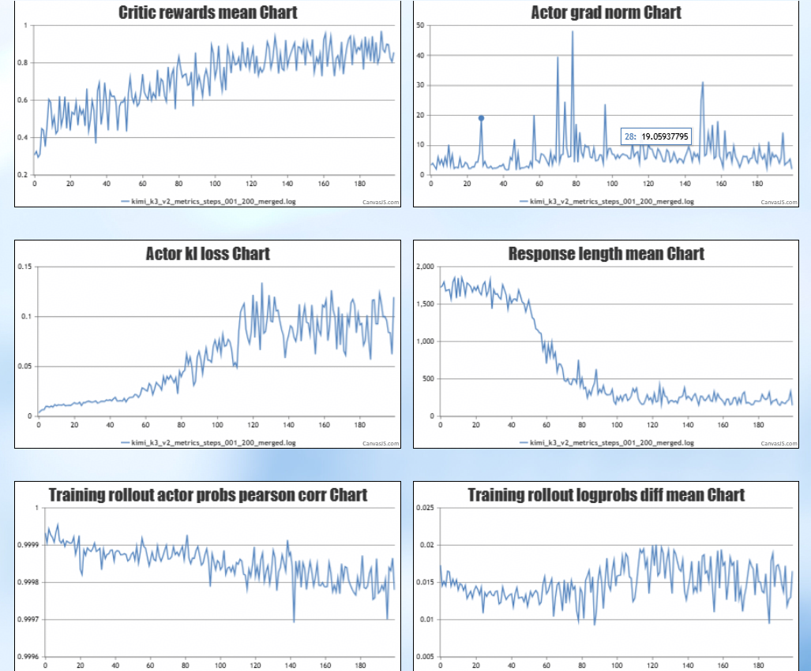

# Kimi K3 FSDPTurbo NPU 使用指南

本文用于指导在 Ascend A3 上使用 verl + FSDPTurbo + vLLM-Ascend 运行 Kimi K3 多模态 MoE GRPO 训练。适配支持动态批量、训练权重同步和 rollout decode 图模式。

## 1. 配套软件版本

| A3 配套软件 | 版本 | 备注 |
| --- | --- | --- |
| Python | 3.12.16 | |
| CANN | 9.2.1 | |
| torch | 2.10.0+cpu | |
| torch-npu | 2.10.0.post7 | |
| vLLM | 0.30.0+empty | |
| transformers | 5.14.1 | |
| triton | 3.6.0 | |
| triton-ascend | 3.6.0.post2 | |
| flash-linear-attention | 0.6.0 | |
| triton-ascend-kernels | 0.1.dev167+g3365d7053 | |
| verl | main | 基于3c6d9b43b67c74ec343d77874cd8fa6e841523da基线应用 Patch |
| FSDPTurbo | main | 基于1fa40ad350eb681ed413ca64bffedc166c986e0f基线应用 Patch |
| vllm-ascend | v0.30.0 | 基于cb629ea1925a280d57b41b48416a85097f6cdb6b基线应用 Patch |

| A5 配套软件 | 版本 | 备注 |
| --- | --- | --- |
| Python | 3.12.15 | |
| CANN | 9.2.1 | |
| torch | 2.10.0 | |
| torch-npu | 2.10.0.post6 | |
| vLLM | 0.30.0+empty | |
| transformers | 5.16.1 | |
| triton | 3.5.0 | |
| triton-ascend | 3.2.2 | |
| flash-linear-attention | 0.5.2 | |
| triton-ascend-kernels | 0.1.dev1+gd4bb38e3e.d20261027 | |
| verl | main | 基于3c6d9b43b67c74ec343d77874cd8fa6e841523da基线应用 Patch |
| FSDPTurbo | main | 基于1fa40ad350eb681ed413ca64bffedc166c986e0f基线应用 Patch |
| vllm-ascend | v0.30.0 | 基于cb629ea1925a280d57b41b48416a85097f6cdb6b基线应用 Patch |

请使用满足上述版本要求的 Ascend NPU 环境，并同时准备配套源码、Python 依赖及编译产物。源码版本与算子编译产物需要匹配。

## 2. A3 四节点环境部署与启动
```bash
# A3 创建容器（每台宿主机执行）
IMAGE=quay.io/albert54/verl:kimi-k3-fsdpturbo-vllm-cann921-a3-1109
CONTAINER=rl_test
WORK=/mnt/share/kimi-k3-a3
LOCAL=/var/tmp/kimi-k3-a3
mkdir -p "$WORK" "$LOCAL/tmp" "$LOCAL/cache" "$LOCAL/ascend"

docker pull "$IMAGE"
docker run -dit --init --name "$CONTAINER" --hostname "$(hostname -s)" \
  --network host --shm-size=32g --privileged \
  --entrypoint /bin/bash \
  -v /usr/local/Ascend/driver:/usr/local/Ascend/driver:ro \
  -v /usr/local/Ascend/firmware:/usr/local/Ascend/firmware:ro \
  -v /usr/local/sbin:/usr/local/sbin:ro \
  -v /mnt/share:/mnt/share \
  -v "$LOCAL/tmp:/tmp" \
  -v "$LOCAL/cache:/root/.cache" \
  -v "$LOCAL/ascend:/root/ascend" \
  "$IMAGE" -c 'sleep infinity'
docker exec -it "$CONTAINER" bash
```

```bash
# 准备工作目录
WORK=/mnt/share/kimi-k3-a3
mkdir -p "$WORK"
cd "$WORK"

# 下载源码
git clone https://github.com/verl-project/verl-ascend-recipe.git "$WORK/verl-ascend-recipe"
git clone https://github.com/verl-project/verl.git "$WORK/verl"
git clone https://gitcode.com/Ascend/FSDPTurbo.git "$WORK/FSDPTurbo"
git clone https://github.com/vllm-project/vllm.git "$WORK/vllm"
git clone https://github.com/vllm-project/vllm-ascend.git "$WORK/vllm-ascend"

# check到指定commit
git -C "$WORK/verl" checkout --detach 3c6d9b43b67c74ec343d77874cd8fa6e841523da
git -C "$WORK/FSDPTurbo" checkout --detach 1fa40ad350eb681ed413ca64bffedc166c986e0f
git -C "$WORK/vllm" checkout --detach ced6857afa0ea7b2e3f0846a62e1394e90f15607
git -C "$WORK/vllm-ascend" checkout --detach cb629ea1925a280d57b41b48416a85097f6cdb6b

# 应用Patch
PATCH_DIR="$WORK/verl-ascend-recipe/Kimi-K3/patch"
git -C "$WORK/verl" -c user.name='A3 setup' -c user.email='a3-setup@localhost' am --keep "$PATCH_DIR/verl.patch"
git -C "$WORK/FSDPTurbo" -c user.name='A3 setup' -c user.email='a3-setup@localhost' am --keep "$PATCH_DIR/fsdpturbo.patch"
git -C "$WORK/vllm-ascend" -c user.name='A3 setup' -c user.email='a3-setup@localhost' am --keep "$PATCH_DIR/vllm-ascend.patch"
git -C "$WORK/vllm-ascend" submodule update --init --recursive

cp "$WORK/verl-ascend-recipe/Kimi-K3/examples/ray_start_4nodes_a3.sh" "$WORK/"
# 脚本若经 Windows 下载或复制，统一为 Unix LF 换行。
sed -i 's/\r$//' "$WORK/ray_start_4nodes_a3.sh"
```

源码准备完成后，在四个容器中分别执行以下安装命令。先加载 CANN，再加载 ATB，然后安装四个框架仓库。

```bash
# 在固定 commit 并应用 patch 后，逐个安装工作目录中的框架源码。
WORK=/mnt/share/kimi-k3-a3
source /usr/local/Ascend/ascend-toolkit/set_env.sh
source /usr/local/Ascend/nnal/atb/set_env.sh
cd "$WORK/vllm"
VLLM_TARGET_DEVICE=empty SETUPTOOLS_SCM_PRETEND_VERSION=0.30.0 \
  python3 -m pip install --no-build-isolation --no-deps -v -e .
cd "$WORK/FSDPTurbo"
python3 -m pip install --no-build-isolation --no-deps -v -e .
cd "$WORK/verl"
python3 -m pip install --no-build-isolation --no-deps -v -e .
cd "$WORK/vllm-ascend"
COMPILE_CUSTOM_KERNELS=1 SOC_VERSION=ascend910_9392 MAX_JOBS=32 \
  python3 -m pip install --no-build-isolation --no-deps -v -e .

cd "$WORK"
```

四个容器全部安装完成后，分别执行以下启动命令；节点 IP、网卡名、模型和数据路径按实际环境设置，四个容器使用同一个 `VERL_RUN_NAME`。

```bash
# 启动训练（四个容器分别执行）
export KIMI_RELEASE_ROOT=/mnt/share/kimi-k3-a3
export MASTER_ADDR=192.168.0.4
export KIMI_NODE_IPS='192.168.0.1 192.168.0.2 192.168.0.3 192.168.0.4'
export HCCL_SOCKET_IFNAME=enp48s3u1u1
export GLOO_SOCKET_IFNAME="$HCCL_SOCKET_IFNAME"
export RAY_PORT=6788
# 本次验证运行 10 个训练步骤，可按实验需要调整。
export VERL_TOTAL_TRAINING_STEPS=10
export MODEL_PATH=/mnt/share/models/K3-top16-pruned_bf16_countbench_128_n4
export TRAIN_FILE=/mnt/share/datasets/countbenchqa_lite/train_448.parquet
export VERL_RUN_NAME=kimi_k3_a3_release_run01
export VERL_EXPERIMENT_NAME="$VERL_RUN_NAME"
export VERL_SAVE_ROLLOUT=true
export HYDRA_FULL_ERROR=1
cd "$KIMI_RELEASE_ROOT"

mkdir -p "runs/$VERL_RUN_NAME"
nohup bash ray_start_4nodes_a3.sh \
  > "runs/$VERL_RUN_NAME/launcher.$(hostname -s).log" 2>&1 < /dev/null &
```
## 3. A5 四节点环境部署与启动
```
# A5镜像
docker pull quay.io/albert54/verl:kimi-k3-fsdpturbo-vllm-cann921-a5-1106

# A5创建容器
docker run -dit --ipc=host --network host --name 'rl_test' --privileged -v /usr/local/Ascend/driver:/usr/local/Ascend/driver -v /usr/local/Ascend/firmware:/usr/local/Ascend/firmware -v /usr/local/sbin/:/usr/local/sbin/ -v /home/:/home/ -v /data/:/data 镜像名:标签 /bin/bash

# 进入容器
docker exec -it rl_test bash
mkdir /workspace-verl 
cd /workspace-verl

# 下载源码
git clone https://github.com/verl-project/verl-ascend-recipe.git
git clone https://github.com/vllm-project/vllm-ascend.git && cd vllm-ascend && git switch releases/v0.30.0 && cd ..
git clone https://gitcode.com/Ascend/FSDPTurbo.git
git clone https://github.com/verl-project/verl.git

# check到指定commit
cd verl && git checkout 3c6d9b43b67c74ec343d77874cd8fa6e841523da && cd ..
cd FSDPTurbo && git checkout 1fa40ad350eb681ed413ca64bffedc166c986e0f && cd ..
cd vllm-ascend && git checkout cb629ea1925a280d57b41b48416a85097f6cdb6b && cd ..

# 应用Patch
cd verl && git am --keep ../verl-ascend-recipe/Kimi-K3/patch/verl.patch && cd ..
cd FSDPTurbo && git am --keep ../verl-ascend-recipe/Kimi-K3/patch/fsdpturbo.patch && cd ..
cd vllm-ascend && git am --keep ../verl-ascend-recipe/Kimi-K3/patch/vllm-ascend.patch && cd ..

# 准备多机脚本并修改ROOT、MODEL_PATH_DIR、DATASET_DIR后启动训练
cp verl-ascend-recipe/Kimi-K3/examples/ray_start_4nodes_a5.sh .
bash ray_start_4nodes_a5.sh
```

## 4. 可选：异步训练功能

默认流程只应用 `Kimi-K3/patch/verl.patch`，不包含异步（separate async）权重同步能力。若需使用异步功能，在上述步骤应用 `verl.patch` 之后，再追加应用 `Kimi-K3/patch/verl-separate-async.patch`：

```bash
# A3：在已应用 verl.patch 的 verl 目录中执行
git -C "$WORK/verl" -c user.name='A3 setup' -c user.email='a3-setup@localhost' am --keep "$WORK/verl-ascend-recipe/Kimi-K3/patch/verl-separate-async.patch"

# A5：在已应用 verl.patch 的 verl 目录中执行
cd verl && git am --keep ../verl-ascend-recipe/Kimi-K3/patch/verl-separate-async.patch && cd ..
```

该 patch 包含以下两个 commit，必须基于已应用 `verl.patch` 的 `3c6d9b43b67c74ec343d77874cd8fa6e841523da` 基线使用：

- `[trainer, rollout, fsdp, ckpt] feat: port Kimi separate async weight sync`
- `[trainer] fix: restore base profiler stop timing for separate async`

## 5. 训练效果

以下展示 Kimi K3 16 专家裁剪模型在 Ascend A3 和 A5 上的 GRPO 训练结果。

### 5.1 Ascend A3：4 机、16 专家训练结果

| 配置项 | 配置说明 |
| --- | --- |
| 计算资源 | 4 机，每机 16 个 NPU，共 64 个 NPU |
| 模型 | Kimi K3 16 专家裁剪模型（`K3-top16-pruned_bf16_countbench_128_n4`） |
| 训练步数 | 200 steps|
| 批量与采样 | `TRAIN_BATCH_SIZE=16`，`ROLLOUT_N=4`，`PPO_MINI_BATCH_SIZE=16` |
| 训练并行 | 专家并行 `TURBO_EP_SIZE=16`，上下文并行 `TURBO_CP_SIZE=1` |
| Rollout 并行 | 张量并行 `ROLLOUT_TP=16`，数据并行 `ROLLOUT_DP=1` |
| 最大回答长度 | 2048 tokens |



### 5.2 Ascend A5：4 机、16 专家训练结果

| 配置项 | 配置说明 |
| --- | --- |
| 计算资源 | 4 机，每机 8 个 NPU，共 32 个 NPU |
| 模型 | Kimi K3 16 专家裁剪模型 |
| 训练步数 | 200 steps |
| 批量与采样 | `TRAIN_BATCH_SIZE=16`，`ROLLOUT_N=4`，`PPO_MINI_BATCH_SIZE=16` |
| 训练并行 | 专家并行 `TURBO_EP_SIZE=8`，上下文并行 `TURBO_CP_SIZE=1` |
| Rollout 并行 | 张量并行 `ROLLOUT_TP=8`，数据并行 `ROLLOUT_DP=1` |
| 最大回答长度 | 2048 tokens |


