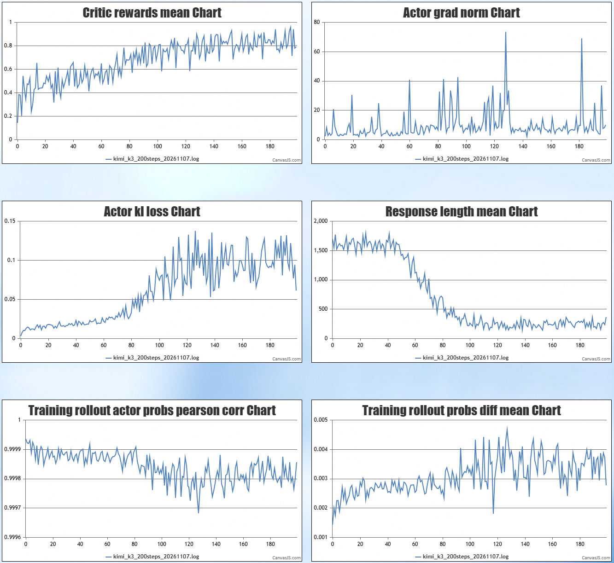

# Kimi K3 FSDPTurbo NPU 使用指南

本文用于指导在 Ascend A3 上使用 verl + FSDPTurbo + vLLM-Ascend 运行 Kimi K3 多模态 MoE GRPO 训练。适配支持动态批量、训练权重同步和 rollout decode 图模式。

## 1. 配套软件版本

| 配套软件 | 版本 | 备注 |
| --- | --- | --- |
| Python | 3.12.15 |
| CANN | 9.2.1 |
| torch | 2.10.0 |
| torch-npu | 2.10.0.post6 |
| vLLM | 0.30.0+empty |
| transformers | 5.16.1 |
| triton | 3.5.0 |
| triton-ascend | 3.2.2 |
| flash-linear-attention | 0.5.2 |
| triton-ascend-kernels | 0.1.dev1+gd4bb38e3e.d20261027 |
| verl | main | 基于3c6d9b43b67c74ec343d77874cd8fa6e841523da基线应用 Patch |
| FSDPTurbo | main | 基于1fa40ad350eb681ed413ca64bffedc166c986e0f基线应用 Patch |
| vllm-ascend | v0.30.0 | 基于cb629ea1925a280d57b41b48416a85097f6cdb6b基线应用 Patch |

请使用满足上述版本要求的 Ascend NPU 环境，并同时准备配套源码、Python 依赖及编译产物。源码版本与算子编译产物需要匹配。

## 环境部署
使用Kimi K3专用镜像
```
# A3镜像
docker pull quay.io/albert54/verl:kimi-k3-fsdpturbo-vllm-cann921-a3-1109

# A5镜像
docker pull quay.io/albert54/verl:kimi-k3-fsdpturbo-vllm-cann921-a5-1106

# 创建容器
docker run -dit --ipc=host --network host --name 'rl_test' --privileged -v /usr/local/Ascend/driver:/usr/local/Ascend/driver -v /usr/local/Ascend/firmware:/usr/local/Ascend/firmware -v /usr/local/sbin/:/usr/local/sbin/ -v /home/:/home/ -v /data/:/data 镜像名:标签 /bin/bash

# 进入容器
docker exec -it rl_test bash
mkdir /workspace-verl 
cd /workspace-verl

# 下载源码
git clone https://github.com/wangdongleix/verl-ascend-recipe.git
git clone https://github.com/vllm-project/vllm-ascend.git && cd vllm-ascend && git switch releases/v0.30.0 && cd ..
git clone https://gitcode.com/Ascend/FSDPTurbo.git
git clone https://github.com/wangdongleix/verl.git

# check到指定commit
cd verl && git checkout 3c6d9b43b67c74ec343d77874cd8fa6e841523da && cd ..
cd FSDPTurbo && git checkout 1fa40ad350eb681ed413ca64bffedc166c986e0f && cd ..
cd vllm-ascend && git checkout cb629ea1925a280d57b41b48416a85097f6cdb6b && cd ..

# 应用Patch
cd verl && git am --keep ../verl-ascend-recipe/Kimi-K3/patch/verl.patch && cd ..
cd FSDPTurbo && git am --keep ../verl-ascend-recipe/Kimi-K3/patch/fsdpturbo.patch && cd ..
cd vllm-ascend && git am --keep ../verl-ascend-recipe/Kimi-K3/patch/vllm-ascend.patch && cd ..

# 准备多机脚本并修改ROOT、MODEL_PATH_DIR、DATASET_DIR后启动训练
cp verl-ascend-recipeKimi-K3/examples/ray_start_4nodes.sh .
bash ray_start_4nodes.sh
```

# 训练效果
