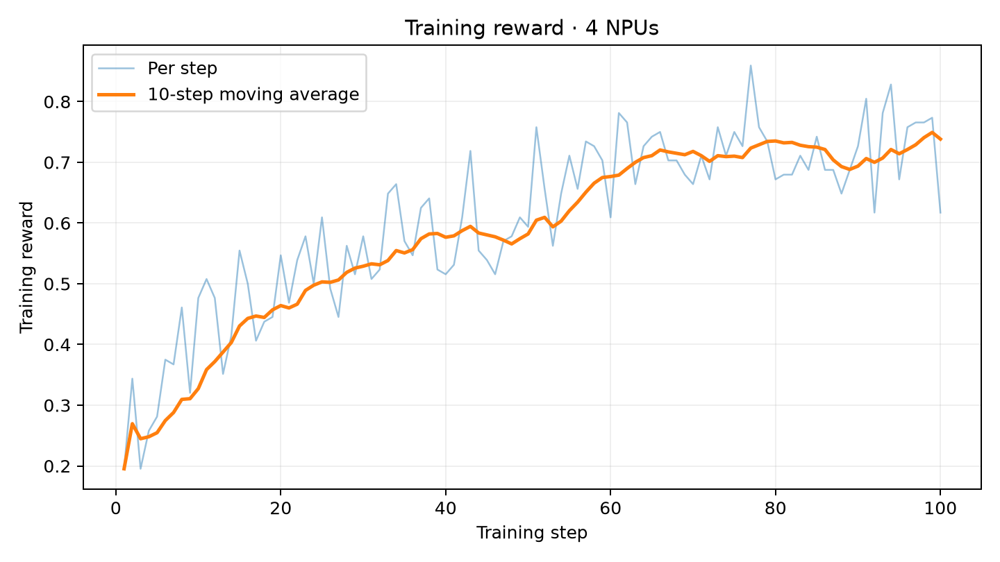
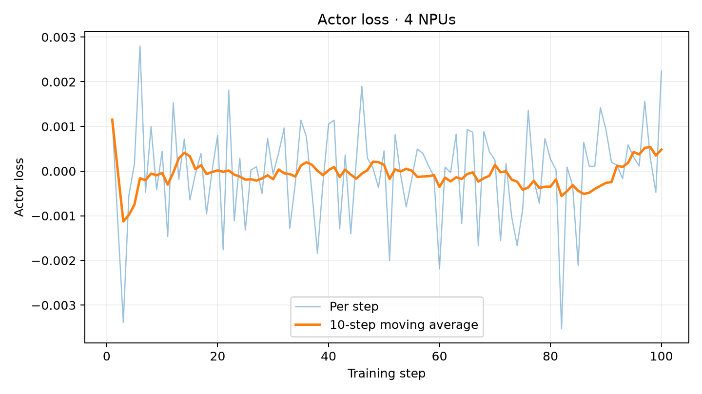

# Qwen3-4B Muon GRPO Ascend Recipe

对应任务：[#72](https://github.com/verl-project/verl-ascend-recipe/issues/72)。

4 张 Ascend 910B3 从初始权重训练 100 步，训练进度记录时长为 3:23:57。reward 首末 10 步均值为 0.327344 → 0.738281，单 NPU TPS 均值为 443.83 tokens/s。

## 训练链路

GSM8K / MATH prompt → vLLM-Ascend TP2（每 prompt 2 条 response）→ 数学规则 reward → GRPO advantage → Megatron TP2/PP2 actor 更新 → rollout 权重同步。二维权重矩阵使用 Muon，其余 embedding、norm、bias、lm_head 等参数沿用 Megatron 的 AdamW 分组。

沿用官方 Megatron GRPO 示例及 [Muon 配置说明](https://github.com/verl-project/verl/blob/main/examples/muon/README.md)。脚本生成运行时兼容模块，补齐 MindSpeed/Bridge provider 默认字段，调用 Megatron-Core 原生 Muon 优化器，并处理 non-layerwise 权重驻留路径。 参考入口为 [官方训练示例](https://github.com/verl-project/verl/blob/main/examples/grpo_trainer/run_qwen3_8b_megatron.sh)。

## 文件

| 路径 | 内容 |
| --- | --- |
| `run_qwen3_4b_muon_megatron_npu.sh` | 训练配置、数据准备与启动入口 |
| `README.md` | 环境、复现命令、关键配置与结果 |
| `assets/reward_curve.png` | reward 逐步值及 10-step moving average |
| `assets/loss_curve.png` | actor loss 逐步值及 10-step moving average |

## 环境

| 组件 | 已验证版本 |
| --- | --- |
| NPU / OS | 4 × Ascend 910B3 / Ubuntu 22.04 |
| HDK / CANN | 26.0.rc1 / 9.1.0 |
| Python | 3.12.13 |
| PyTorch / torch-npu | 2.10.0 / 2.10.0.post4 |
| vLLM / vLLM-Ascend | 0.23.0 / 0.23.0 |
| Ray | 2.58.0 |
| Triton / Triton-Ascend | 3.5.0 / 3.2.2 |
| transformers | 5.3.0 |
| Megatron Core / Megatron Bridge | 0.17.0 / 0.4.2 |
| MindSpeed | 0.12.1 |
| TransformerEngineNPU | 2.13.0 |
| emerging-optimizers | 0.5.0a0 |
| verl | `0.10.0.dev`, `main` @ `fc72e2f384212470868a9928b62baedb9bcc3ff0` |

安装流程见 [verl Ascend 安装指南](https://github.com/verl-project/verl/blob/main/docs/ascend_tutorial/zh/get_start/install_guidance.rst)。启动前加载 CANN 环境并激活安装上述组件的 Python 环境：

```bash
source /usr/local/Ascend/cann-9.1.0/set_env.sh
```

Transformer Engine 使用 [TransformerEngineNPU](https://gitcode.com/Ascend/TransformerEngineNPU) 的 NPU 实现；其安装及依赖见官方仓库。

## 模型与数据

```bash
hf download Qwen/Qwen3-4B --local-dir /path/to/Qwen3-4B
```

数据为 [openai/gsm8k](https://huggingface.co/datasets/openai/gsm8k)（7473 / 1319 条）和 [DigitalLearningGmbH/MATH-lighteval](https://huggingface.co/datasets/DigitalLearningGmbH/MATH-lighteval)（7500 / 5000 条），使用对应训练及验证 parquet，过长 prompt 按配置过滤。

```bash
python /path/to/verl/examples/data_preprocess/gsm8k.py \
  --local_save_dir /path/to/data/gsm8k
python /path/to/verl/examples/data_preprocess/math_dataset.py \
  --local_save_dir /path/to/data/math
```

脚本在 parquet 缺失时调用上述预处理；存在时直接使用。

## 四卡启动

```bash
ASCEND_RT_VISIBLE_DEVICES=0,1,2,3 \
NDEVICES_PER_NODE=4 \
PYTHON_BIN=python \
VERL_ROOT=/path/to/verl \
DATA_ROOT=/path/to/data \
MODEL_PATH=/path/to/Qwen3-4B \
CKPTS_DIR=/path/to/checkpoints/qwen3-4b-muon \
LOG_FILE=/path/to/logs/qwen3-4b-muon/train.log \
RUNTIME_COMPAT_DIR=/path/to/runtime/qwen3-4b-muon \
RAY_TMPDIR=/data/ray72 \
TMPDIR=/data/tmp72 \
TOTAL_TRAINING_STEPS=100 \
bash /path/to/verl-ascend-recipe/grpo/qwen3-4b-muon/run_qwen3_4b_muon_megatron_npu.sh \
  +ray_kwargs.ray_init.include_dashboard=False
```

脚本接收追加的 Hydra overrides。`RAY_TMPDIR` 与 `TMPDIR` 使用短路径。

## 关键配置

| 参数 | 验证值 |
| --- | --- |
| actor / reference topology | Megatron TP2 / PP2 / DP1 |
| rollout topology | TP2，2 replicas |
| train batch / responses per prompt | 64 / 2 |
| PPO mini / micro batch per NPU | 8 / 1 |
| max prompt / response | 1024 / 1024 |
| dynamic batch / token cap per NPU | true / 8192 |
| actor LR / KL coefficient | 1e-6 / 0.001 |
| optimizer / momentum | Muon / 0.95 |
| Nesterov / QKV split / AdamW RMS match | false / true / true |
| scaling / coefficients / NS steps / TP mode | spectral / quintic / 5 / blockwise |
| layerwise / distributed optimizer | false / false |
| rollout memory utilization | 0.35 |
| dtype | BF16 |
| parameter / optimizer offload | false / false |
| chunked prefill / max batched tokens | true / 4096 |
| rollout max sequences | 256 |
| graph mode | `FULL_DECODE_ONLY` |
| graph capture sizes | 4, 8, 16, 32, 64, 128, 256 |
| training steps / save frequency / test frequency | 100 / 100 / 10 |
| Ray CPUs / object store | 48 / 20,000,000,000 bytes |

AdamW 对照使用同一启动命令，改为 `TOTAL_TRAINING_STEPS=10` 并追加：

```bash
actor_rollout_ref.actor.optim.optimizer=adam \
+actor_rollout_ref.actor.optim.override_optimizer_config.decoupled_weight_decay=True \
trainer.save_freq=-1
```

`adam` 加 decoupled weight decay 对应 Megatron 的 AdamW 路径。

## Checkpoint 与日志

默认从初始权重开始，在第 100 步保存最终 actor checkpoint，仅保留一份。每 10 步验证一次，console logger 输出完整训练和验证指标，`LOG_FILE` 保存框架控制台日志。

训练日志：https://gist.github.com/SkyTD256/13b21aa8005d0be63c377048370d37dd

## 指标与结果

reward 使用 `critic/rewards/mean`，比较首 10 步和末 10 步均值；actor loss 使用 `actor/loss`。单 NPU TPS 是全部 100 步 `perf/throughput` 的算术均值，该字段按 `perf/total_num_tokens / perf/time_per_step / 4` 计算。训练 token 包含 prompt 与 response；step time 不包含每 10 步的独立验证时间，包含最终 checkpoint 的保存计时。进度记录时长和启动至退出总时长包含验证。四卡聚合 TPS 为单 NPU 值乘 4。

| 指标 | 结果 |
| --- | ---: |
| 训练进度记录时长 / 完成步数 | 3:23:57 / 100 |
| 启动至退出总时长 / 退出状态 | 03:31:04 / 0 |
| reward 首 10 步 / 末 10 步均值 | 0.327344 / 0.738281 |
| reward 增量 | +0.410938 |
| actor loss 均值 / 范围 | -0.000039 / -0.003526 至 0.002802 |
| 单 NPU TPS 均值 / 首 10 步均值 | 443.83 / 471.51 tokens/s |
| 四卡聚合 TPS | 1775.33 tokens/s |
| 平均训练 step 时间 | 64.32 s |
| 训练处理 token 总数 | 11,080,867 |

### Muon 与 AdamW 显存对照

使用同一模型、四卡 TP2/PP2、batch 64、mini batch 8、micro batch 1、8192 token 动态上限和 rollout 设置，AdamW 对照运行 10 步。

| 优化器 | actor 峰值 allocated memory（GiB） |
| --- | ---: |
| Muon（完整 100 步） | 34.1651 |
| AdamW（10 步对照） | 37.5182 |

Muon 的 actor 峰值显存比 AdamW 对照低 8.94%。

AdamW 对照日志：https://gist.github.com/SkyTD256/13b21aa8005d0be63c377048370d37dd




