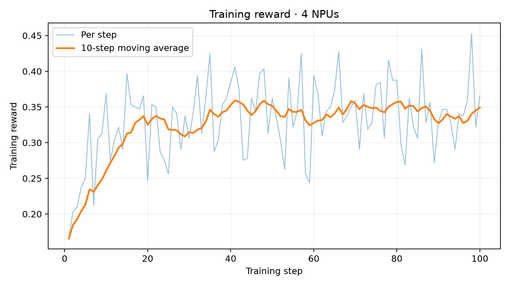
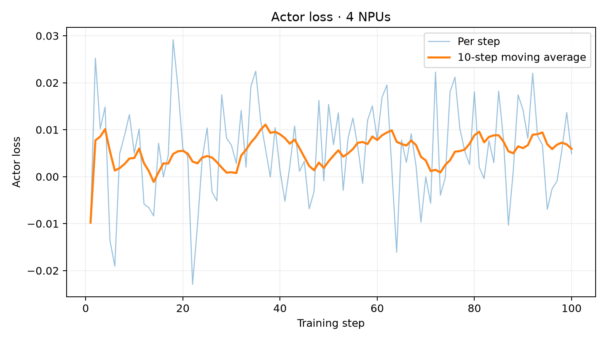

# Qwen3.5-2B Open-R1 Multimodal GRPO Ascend Recipe

对应任务：[#76](https://github.com/verl-project/verl-ascend-recipe/issues/76)。

4 张 Ascend 910B3 从初始权重训练 100 步，训练进度记录时长为 16:00:07。reward 首末 10 步均值为 0.260625 → 0.349063，单 NPU TPS 均值为 131.72 tokens/s。

## 训练链路

Open-R1 图像与数学问题 → vLLM-Ascend TP1（每 prompt 5 条 response）→ 答案正确性 reward → GRPO advantage → FSDP2 actor 更新与 KL loss → rollout 权重同步。

沿用官方 Qwen3.5-2B Open-R1 示例。脚本生成一个答案 reward 模块：提取 `<answer>` 或 boxed 答案，先比较规范化结果，再使用 verl 数学等价检查，正确返回 1，否则返回 0。 参考入口为 [官方训练示例](https://github.com/verl-project/verl/blob/main/examples/grpo_trainer/run_qwen3_5_2b_openr1_fsdp.sh)。

## 文件

| 路径 | 内容 |
| --- | --- |
| `run_qwen3_5_2b_openr1_fsdp2_npu.sh` | 训练配置、数据准备与启动入口 |
| `README.md` | 环境、复现命令、关键配置与结果 |
| `assets/reward_curve.png` | reward 逐步值及 10-step moving average |
| `assets/loss_curve.png` | actor loss 逐步值及 10-step moving average |

## 环境

| 组件 | 已验证版本 |
| --- | --- |
| NPU / OS | 4 × Ascend 910B3 / Ubuntu 22.04 |
| HDK / CANN | 26.0.rc1 / 9.1.0 |
| Python | 3.12.13 |
| PyTorch / torch-npu | 2.10.0 / 2.10.0.post4 |
| vLLM / vLLM-Ascend | 0.23.0 / 0.23.0 |
| Ray | 2.58.0 |
| Triton / Triton-Ascend | 3.5.0 / 3.2.2 |
| transformers | 5.10.4 |
| xgrammar | 0.1.33 |
| verl | `0.10.0.dev`, `main` @ `fc72e2f384212470868a9928b62baedb9bcc3ff0` |

安装流程见 [verl Ascend 安装指南](https://github.com/verl-project/verl/blob/main/docs/ascend_tutorial/zh/get_start/install_guidance.rst)。启动前加载 CANN 环境并激活安装上述组件的 Python 环境：

```bash
source /usr/local/Ascend/cann-9.1.0/set_env.sh
```


## 模型与数据

```bash
hf download Qwen/Qwen3.5-2B --local-dir /path/to/Qwen3.5-2B
```

数据为 [lmms-lab/multimodal-open-r1-8k-verified](https://huggingface.co/datasets/lmms-lab/multimodal-open-r1-8k-verified)，使用官方预处理保留图像原始字节，并按 seed 42 划分 90% 训练、10% 验证（6920 / 769 条，过长 prompt 按配置过滤）。

```bash
python /path/to/verl/examples/data_preprocess/openr1mm.py \
  --local_save_dir /path/to/data/openr1mm
```

脚本在 parquet 缺失时调用上述预处理；存在时直接使用。

## 四卡启动

```bash
ASCEND_RT_VISIBLE_DEVICES=0,1,2,3 \
NDEVICES_PER_NODE=4 \
PYTHON_BIN=python \
VERL_ROOT=/path/to/verl \
RAY_DATA_HOME=/path/to/workspace \
MODEL_PATH=/path/to/Qwen3.5-2B \
DATA_DIR=/path/to/data/openr1mm \
TRAIN_FILE=/path/to/data/openr1mm/train.parquet \
TEST_FILE=/path/to/data/openr1mm/test.parquet \
CKPTS_DIR=/path/to/checkpoints/qwen3.5-2b \
LOG_DIR=/path/to/logs/qwen3.5-2b \
LOG_FILE=/path/to/logs/qwen3.5-2b/train.log \
RUNTIME_DIR=/path/to/runtime/qwen3.5-2b \
RAY_TMPDIR=/data/ray76 \
TMPDIR=/data/tmp76 \
TOTAL_TRAINING_STEPS=100 \
bash /path/to/verl-ascend-recipe/grpo/qwen3.5-2b/run_qwen3_5_2b_openr1_fsdp2_npu.sh \
  ray_kwargs.ray_init.num_cpus=48 \
  +ray_kwargs.ray_init.object_store_memory=20000000000 \
  +ray_kwargs.ray_init.include_dashboard=False
```

脚本接收追加的 Hydra overrides。`RAY_TMPDIR` 与 `TMPDIR` 使用短路径。

## 关键配置

| 参数 | 验证值 |
| --- | --- |
| actor / reference topology | FSDP2 size 4 / sequence parallel 1 |
| rollout topology | TP1，4 replicas |
| train batch / responses per prompt | 64 / 5 |
| PPO mini / micro batch per NPU | 16 / 2 |
| max prompt / response | 2048 / 1536 |
| dynamic batch / shuffle | false / false |
| actor LR / KL coefficient | 5e-7 / 0.02 |
| gradient checkpointing / remove padding | true / false |
| entropy chunking / checkpointing | true / true |
| rollout memory utilization / prefix caching | 0.40 / false |
| weight update bucket | 6144 MiB |
| dtype | BF16 |
| parameter / optimizer offload | false / false |
| chunked prefill / max batched tokens | true / 4096 |
| rollout max sequences | 256 |
| graph mode | `FULL_DECODE_ONLY` |
| graph capture sizes | 4, 8, 16, 32, 64, 128, 256 |
| training steps / save frequency / test frequency | 100 / 100 / 10 |
| Ray CPUs / object store | 48 / 20,000,000,000 bytes |

## Checkpoint 与日志

默认从初始权重开始，在第 100 步保存最终 actor checkpoint，仅保留一份。每 10 步验证一次，console logger 输出完整训练和验证指标，`LOG_FILE` 保存框架控制台日志。

训练日志：https://gist.github.com/SkyTD256/45a9a974aa4869d1b1f7c63be4bf7db6

## 指标与结果

reward 使用 `critic/rewards/mean`，比较首 10 步和末 10 步均值；actor loss 使用 `actor/loss`。单 NPU TPS 是全部 100 步 `perf/throughput` 的算术均值，该字段按 `perf/total_num_tokens / perf/time_per_step / 4` 计算。训练 token 包含 prompt 与 response；step time 不包含每 10 步的独立验证时间，包含最终 checkpoint 的保存计时。进度记录时长和启动至退出总时长包含验证。四卡聚合 TPS 为单 NPU 值乘 4。

| 指标 | 结果 |
| --- | ---: |
| 训练进度记录时长 / 完成步数 | 16:00:07 / 100 |
| 启动至退出总时长 / 退出状态 | 16:15:04 / 0 |
| reward 首 10 步 / 末 10 步均值 | 0.260625 / 0.349063 |
| reward 增量 | +0.088438 |
| actor loss 均值 / 范围 | 0.005476 / -0.022946 至 0.029148 |
| 单 NPU TPS 均值 / 首 10 步均值 | 131.72 / 135.54 tokens/s |
| 四卡聚合 TPS | 526.88 tokens/s |
| 平均训练 step 时间 | 571.27 s |
| 训练处理 token 总数 | 30,120,038 |




