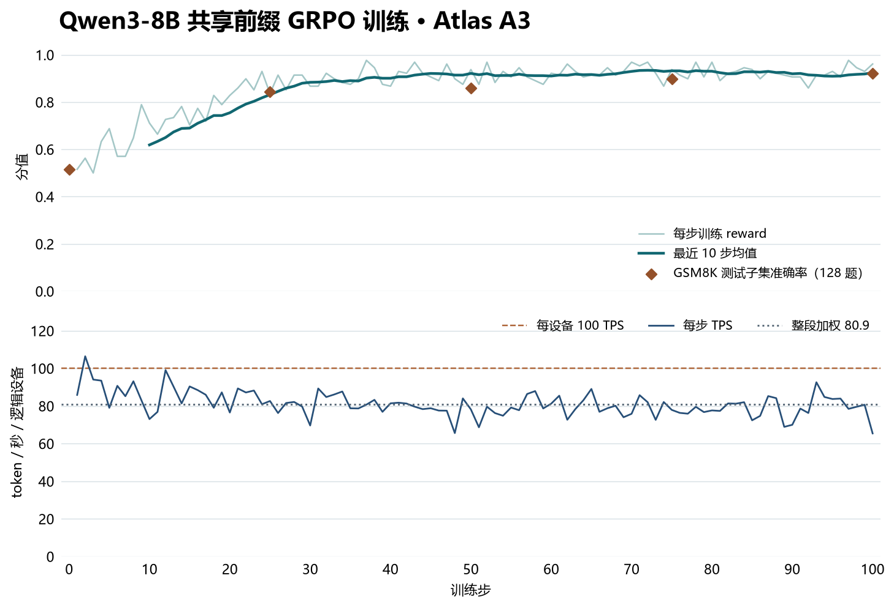

# Qwen3-8B 在昇腾 Megatron 上的共享前缀训练

此配方在 GSM8K 上运行 GRPO。vLLM-Ascend 为每条 prompt 采样多个回答，Megatron 的 actor 和 reference 在同一微批中复用 prompt 的前向计算。训练目标仍按原回答逐条计算。

## 所需 verl 版本

本配方固定使用 `4a9dc911d57062d76988e0fd1f2468b5e7178ce3`。安装步骤见下文的「应用与运行」。[版本声明](REQUIRED_VERL.txt) · [实践报告](../verl_ascend_practice/reports/prefix_grouper/README.md)

## 100 步训练结果

在 8 个 A3 逻辑设备上以 64 条 prompt 为一个全局 batch，每条采样 2 个回答。actor、reference 和 rollout 均使用 TP=2，actor 的 DP=4。prompt 上限为 512 token，回答上限为 384 token。连续 100 次参数更新共处理 3,761,012 个有效 token。首 10 步平均 reward 为 **0.61875**，末 10 步为 **0.92422**。

| 训练步 | 0 | 25 | 50 | 75 | 100 |
| --- | ---: | ---: | ---: | ---: | ---: |
| GSM8K 答对数（固定 128 题） | 66 | 108 | 110 | 115 | 118 |
| 准确率 | 51.56% | 84.38% | 85.94% | 89.84% | 92.19% |

验证集取自官方 test 划分，固定种子 42，使用贪心解码。100 步累计计时 5,809.09 秒。按 verl 的整步口径计算，吞吐为每逻辑设备 **80.93 TPS**，8 个设备合计 **647.44 TPS**；该 batch 配置低于每设备 100 TPS。无可比 A100 实测记录，本次采用无 GPU 标杆的验收条件。[逐步指标](accept05/metrics.jsonl) · [训练核验日志](accept05/console.log) · [100 步核验报告](evidence/100-step-verification.json)

共记录 12,800 条 actor 更新的 rank 日志。按日志汇总，打包前为 7,522,024 个 token，节省 1,107,158 个，占 **14.72%**。两个 TP rank 会各自报告同一微批，这两个总数都含重复记录，比例按同一口径计算。此比例衡量实际省去的前缀 token 计算量。



## 10 步吞吐测量

为检验大 batch 下的训练吞吐，使用相同的 Qwen3-8B 初始权重、GSM8K 数据、8 个 A3 逻辑设备、GRPO 目标、前缀实现和序列长度。将全局 batch 与 PPO mini-batch 一起调到 256 个 prompt。每个 rollout 副本最多同时处理 128 条序列，批内 token 上限为 8,192。每一步均包含 vLLM-Ascend 采样、Megatron 旧策略和 reference 打分、actor 更新及权重同步。

连续 10 个完整步骤均计入统计，共计 **1,693,428** 个有效 token、**1,158.31 秒**，全程吞吐为 **182.75 TPS / 逻辑设备**，集群合计 **1,461.98 TPS**。每步吞吐范围为 167.05–194.54。这里的 10 步是本次性能测量窗口。100 步精度验证和 10 步吞吐结果分别对应各自的 batch 配置。[性能报告](evidence/performance-verification.json) · [逐步指标](perf256/metrics.jsonl) · [性能核验日志](perf256/console.log)

按「应用与运行」一节配置训练容器后，使用新的目录复现性能测试。

```bash
export RUN_DIR=/experiment/performance-256
TRAIN_BATCH_SIZE=256 PPO_MINI_BATCH_SIZE=256 \
ROLLOUT_MAX_NUM_SEQS=128 ROLLOUT_MAX_NUM_BATCHED_TOKENS=8192 \
TOTAL_TRAINING_STEPS=10 VAL_BEFORE_TRAIN=False TEST_FREQ=-1 SAVE_FREQ=-1 \
bash "$RECIPE/run_qwen3_8b_megatron_npu.sh"
python "$RECIPE/verify_metrics.py" "$RUN_DIR" --device A3 --performance-only
```

## 算法与适用范围

- 使用 verl 的样本 UID 将同一 prompt 的回答分组。打包前核对有效 prompt token 和位置完全相同。一个微批里每个 prompt 只保留一份，每条回答保留自己的 token。
- 将每条回答的 RoPE 位置映射回原始序列。A3 融合注意力接收完整的布尔掩码，每个回答只能看到所属 prompt 和该回答的历史 token。激活重计算也使用相同掩码。
- 不同回答的首 token 可能不同。它们从共享 prompt 末位的 logits 分别取各自标签的 log-prob。梯度按索引累加回共享位置，再沿用 verl 的 GRPO 损失及样本权重。
- 适配范围为稠密 Qwen3、BF16、静态微批、单节点数据并行、TP=1 或 2、PP=CP=1。关闭 sequence parallel、remove padding、fused LM head 和 dropout。分支掩码的空间随单个微批打包后的 token 数平方增长，应同时控制最大回答长度和每组回答数。
- 运行时检查 RoPE 重映射以及每层融合注意力是否执行，日志按 `phase=train` 和 `phase=infer` 区分 actor 更新和 log-prob 计算。对比 `original_tokens` 与 `packed_tokens` 可以核实每个微批实际节省的 token 数。

## 软件与数据

本次选用上游 A3 镜像 `quay.io/ascend/verl:v0.9.1-cann9.1.0-torch_npu2.10.0.post4-a3-ubuntu22.04-py3.12-vllm`，镜像清单摘要为 `sha256:d93ada97b5db6c0a50db2191a7799496037eadb5309d6fd430d0ad1e0d1dec37`。实测可见 8 个 Ascend910_9382 设备。运行模块、数据和模型配置的 SHA-256 见[版本与文件摘要](evidence/provenance.txt)。容器内实际版本、模型分片数和数据行数见[环境摘要](evidence/versions.log)。

该镜像包含可选的 `nvidia-resiliency-ext 0.4.1`。Megatron 的导入探测要求 0.6.0 或更高，在干净镜像中访问 `__version__` 失败。本次在任务专属容器内移除了旧版可选包，使用同步 checkpoint 路径。基础镜像、宿主机和其他环境无需更改。

训练使用 Qwen3-8B 的五个原始 BF16 safetensors 分片，以及按 verl 的 GSM8K 示例处理的 `train.parquet`、`test.parquet`。两者分别含 7,473、1,319 条数据，字段包括 `prompt`、`data_source` 和 `reward_model.ground_truth`。默认关闭 Qwen3 thinking，使用包含 `####` 数值答案的 GSM8K 提示和上游规则奖励。[数据处理脚本](https://github.com/verl-project/verl/blob/4a9dc911d57062d76988e0fd1f2468b5e7178ce3/examples/data_preprocess/gsm8k.py)

## 应用与运行

在已加载 CANN 与 ATB 环境的训练容器内准备干净的 verl 工作树。`RECIPE` 指向此配方目录，`VERL` 指向新检出的 verl 源码。

```bash
export RECIPE=/path/to/verl-ascend-recipe/prefix_grouper
export VERL=/path/to/verl
git clone https://github.com/verl-project/verl.git "$VERL"
git -C "$VERL" checkout --detach 4a9dc911d57062d76988e0fd1f2468b5e7178ce3
git -C "$VERL" apply --check "$RECIPE/patches/verl.patch"
git -C "$VERL" apply "$RECIPE/patches/verl.patch"
cp "$RECIPE/megatron_prefix_grouper.py" "$VERL/verl/models/mcore/"
export PYTHONPATH="$VERL${PYTHONPATH:+:$PYTHONPATH}"
python "$RECIPE/test_megatron_prefix_grouper.py" --device=npu -v
torchrun --standalone --nproc-per-node=1 "$RECIPE/test_megatron_model_npu.py"
torchrun --standalone --nproc-per-node=2 "$RECIPE/test_megatron_model_npu.py" --tp 2
```

在新运行目录中启动训练，每项设置可使用脚本中的环境变量覆盖。配方默认运行 100 步。下面的命令复现上述配置，并在第 100 步保存模型。

```bash
export MODEL_PATH=/models/Qwen3-8B
export DATA_ROOT=/datasets/gsm8k
export NPUS_PER_NODE=8
export RUN_DIR=/experiment/acceptance
SAVE_FREQ=100 bash "$RECIPE/run_qwen3_8b_megatron_npu.sh" \
    'actor_rollout_ref.actor.checkpoint.save_contents=[model]'
python "$RECIPE/verify_metrics.py" "$RUN_DIR" --device A3
```

## A3 实测与调优

在每卡 64 GiB 的 A3 上，TP=1 加默认 FP32 梯度缓冲在初始化分布式优化器时显存不足。DDP 申请 30.51 GiB，设备当时可用 29.66 GiB。启用 precision-aware optimizer，指定 BF16 的 `main_grads_dtype` 后，8,190,735,360 参数的 actor 完成初始化。8 个 TP=1 的 rollout 副本在并行启动时曾出现 TCPStore 端口冲突。最终配方使用 4 个 TP=2 的副本。100 步运行的平均单步耗时中，生成占 24.37 秒，actor 更新占 16.76 秒，reference 和旧策略的 log-prob 分别占 7.14 秒和 4.49 秒，权重同步占 5.15 秒。

使用相同随机权重构造两层真实 Megatron GPTModel，比较共享前缀与逐条 causal 前向，分别回传三个分支及其联合损失，并核对全部 19 个参数张量。每次反传均观察到两层激活重计算。真实训练还暴露了跨 logits 分块共享温度张量引起的原地修改错误。修复为每个分块持有独立温度后，154 个 token、两块 logits 的 TP=2 回归在两个 rank 上均完成反向验证。TP=1 联合损失的最大参数梯度相对 L2 误差为 0.00642，TP=2 两个 rank 上分别为 0.00780 和 0.00611。[TP=1 测试结果](evidence/megatron-tp1.log) · [TP=2 测试结果](evidence/megatron-tp2.log)

## 如何核对结果

[NPU 单测结果](evidence/npu-unit.log) 包含真实融合算子的 BF16 前向和 Q、K、V 梯度对照。测试使用 32 个查询头、8 个 KV 头和 128 维头宽，参考值由逐条回答的 FP32 注意力计算。其余测试覆盖位置映射、不同分支互不可见、分支首 token、损失及参数梯度。

公开的控制台日志按原序保留启动器报告的设备型号、每一条 actor 训练微批的行数与 token 计数，以及运行结束标记。训练微批记录省略了进程前缀，测试日志保留逐项结果与最终状态。两次运行的逐步指标均为 verl 写出的原始 JSONL。

训练验收读取同一运行的 `metrics.jsonl` 和 `console.log`。无匹配的 A100 基线时，核对 100 步或 12 小时、reward 上升和 TPS 大于 100。为使口径可复核，脚本报告最初和最后各至多 10 步的平均 reward，以整步耗时对 verl 的每卡 `perf/throughput` 进行加权，同时报告集群 TPS。正式比较使用严格的每卡阈值。每次运行使用独立目录。短程诊断使用 `--smoke`。

A2/A100 对照需使用相同模型权重、数据、训练步数、采样及评测配置，并保存两次独立的日志。配方将平均 reward 误差定义为逐步绝对差均值除以 A100 reward 绝对值均值，下游评测使用同名 GSM8K 单答指标的相对误差。任务书未指定这两个计算公式。[社区任务](https://www.hiascend.com/activities/task-center/details/806155ae38c64881978be705beae6d09) · [任务书](https://github.com/verl-project/verl-ascend-recipe/issues/24)
