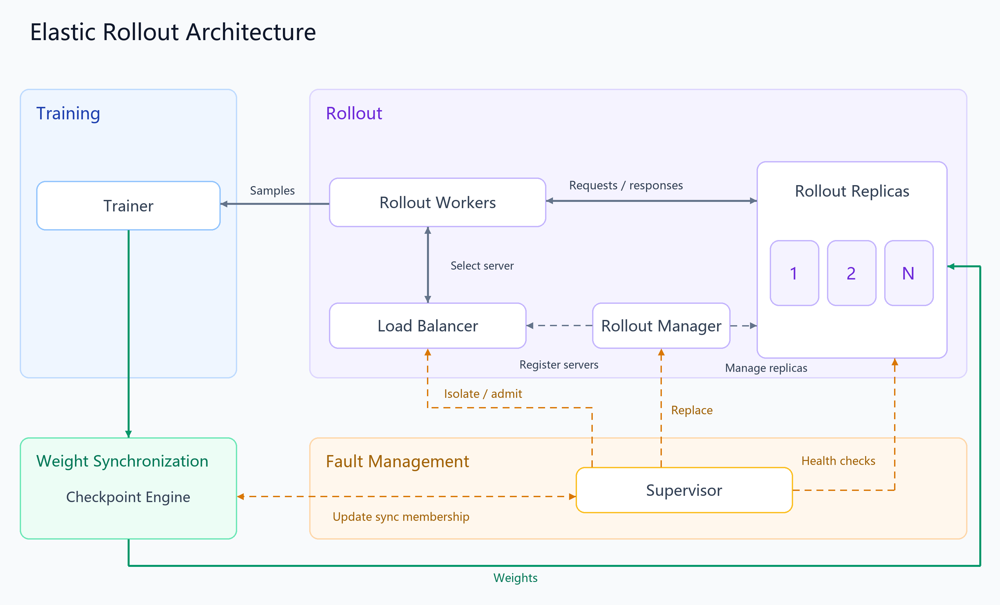

# Elastic Rollout for verl

Elastic Rollout provides rollout fault recovery for reinforcement learning workloads built on **verl 0.9.0** with disaggregated training and inference. It detects failed rollout replicas, retries failed inference requests and weight transfers, and attempts to replace failed replicas to restore rollout capacity. Optional token-level generation resumption reuses persisted progress after a fault.

The recipe builds on verl's fully-async and one-step-off execution paths and checkpoint engine. It applies Python patches at import time without modifying the installed verl source files.

**Recommended deployment:** [Kubernetes + MindCluster / Volcano on Ascend](https://gitcode.com/liuyuqin/mindcluster-deploy/tree/master/samples/reinforcement-learning/verl/elastic-rollout).

[Compatibility](#compatibility) · [Architecture](#architecture) · [Features](#features) · [Installation and deployment](#installation-and-deployment) · [Configuration reference](#configuration-reference)

## Compatibility

This recipe targets **verl 0.9.0**, as specified in [REQUIRED_VERL.txt](REQUIRED_VERL.txt). Use consistent versions of verl, this recipe and inference dependencies across the driver and all Ray workers. Revalidate patch compatibility when upgrading verl.

| Category | Supported configurations |
| --- | --- |
| Execution mode | Fully-async; one-step-off |
| Algorithm | PPO; GRPO |
| Training backend | FSDP; Megatron |
| Rollout backend | vLLM; SGLang and TensorRT-LLM are not supported by this recipe |
| Weight synchronization | NCCL / HCCL, depending on the platform backend |
| Deployment reference | Ascend NPU + Kubernetes + MindCluster / Volcano + Ray |
| Ray | Node-label placement requires Ray >= 2.49; patch regression tests use Ray 2.55.1 |

The table lists supported components; not all combinations have been validated end to end. Kubernetes on Ascend is the primary validated deployment environment.

## Architecture



| Component | Responsibility |
| --- | --- |
| Trainer | Consumes samples and updates model weights using FSDP or Megatron. |
| Rollout Workers | Execute agent loops, issue inference requests and produce training samples. |
| Load Balancer | Selects healthy servers for clients and maintains routing state. |
| Rollout Manager | Manages replica creation, removal and replacement, and registers server handles. |
| Rollout Replicas | Run vLLM inference services and generate model responses. |
| Checkpoint Engine | Transfers model weights from training workers to rollout replicas, with timeouts and bounded retries. |
| Supervisor | Detects failed replicas and coordinates the removal of failed replicas from routing, replica replacement and weight-sync group membership updates. |

New replicas receive the current model weights before serving requests. See [Design Overview](DESIGN.md) and the [upstream RFC](https://github.com/verl-project/verl/discussions/4381) for details.

## Features

| Feature | Description |
| --- | --- |
| Inference Request Retries | Retries failed or timed-out inference requests on healthy replicas within a bounded retry budget. |
| Token-Level Generation Resumption | Resumes interrupted generation from persisted progress to reduce recomputation, subject to the configured model-version policy. |
| Dynamic Rollout Scaling | Supports adding, removing, and replacing rollout replicas at runtime. New replicas serve requests only after synchronizing model weights. |

## Installation and deployment

### 1. Prepare the environment

Refer to the upstream [Ascend image tags and Dockerfiles](https://github.com/verl-project/verl/blob/main/docker/ascend/supported_tags.md) to build an image for your Ascend device with compatible CANN, torch-npu and vLLM/Ascend dependencies. Use the same image on all nodes.

**Download the source on the host**

Check out **verl v0.9.0** and copy the recipe's patch directory into the verl checkout:

```bash
export WORKSPACE="${WORKSPACE:-$HOME/verl-workspace}"
mkdir -p "$WORKSPACE"
cd "$WORKSPACE"
git clone --branch v0.9.0 --depth 1 https://github.com/verl-project/verl.git verl
git clone https://github.com/verl-project/verl-ascend-recipe.git
cp -r verl-ascend-recipe/rollout_elastic verl/
```

Copy the deployment scripts from the [best-practice directory](https://gitcode.com/liuyuqin/mindcluster-deploy/tree/master/samples/reinforcement-learning/verl/elastic-rollout) into `$WORKSPACE/verl/vcjob/`. Set the code volume's `hostPath.path` in the job YAML to the absolute path of `$WORKSPACE/verl`. The host-to-container mapping is:

```text
$WORKSPACE/verl/             -> /verl/
├── pyproject.toml
├── verl/                    -> /verl/verl/
├── rollout_elastic/          -> /verl/rollout_elastic/
└── vcjob/                   -> /verl/vcjob/
```

### 2. Configure the job

**Select the execution mode and training backend**

| Execution mode | FSDP | Megatron |
| --- | --- | --- |
| Fully-async | [fully_async_ppo_trainer.yaml](experimental/fully_async_policy/config/fully_async_ppo_trainer.yaml) | [fully_async_ppo_megatron_trainer.yaml](experimental/fully_async_policy/config/fully_async_ppo_megatron_trainer.yaml) |
| One-step-off | [one_step_off_ppo_trainer.yaml](experimental/one_step_off_policy/config/one_step_off_ppo_trainer.yaml) | [one_step_off_ppo_megatron_trainer.yaml](experimental/one_step_off_policy/config/one_step_off_ppo_megatron_trainer.yaml) |

**Enable fault recovery**

| Feature | Configuration parameter | Required value |
| --- | --- | --- |
| Rollout fault recovery | `async_training.fault_tolerance.enabled` | `True` |
| Token-level generation resumption (optional; requires fault recovery) | `async_training.fault_tolerance.progress.enabled` | `True` |

When applying Hydra command-line overrides, prefix parameters absent from the selected YAML configuration with `++`.

**Allocate resources**

Allocate dedicated NPUs to training and rollout. The Kubernetes example uses three Pod roles:

| Pod role | Responsibility | NPU allocation |
| --- | --- | --- |
| Head | Ray head node and job driver | No NPUs |
| Trainer | Model training and CPU-based coordination | Dedicated training NPUs |
| Rollout | Standalone inference replicas | Dedicated rollout NPUs; one replica per Pod |

Keep resource counts consistent between the job YAML and submission scripts:

| Resource | Manifest and script settings |
| --- | --- |
| Training Pods | Trainer Pod count = `NNODES_TRAIN`; NPUs per Pod = `N_NPUS_TRAIN` |
| Rollout Pods | Rollout Pod count = `NNODES_ROLLOUT`; NPUs per Pod = `N_NPUS_ROLLOUT` |
| Total job NPUs | `TOTAL_NPU = NNODES_TRAIN × N_NPUS_TRAIN + NNODES_ROLLOUT × N_NPUS_ROLLOUT`; Head uses no NPUs |

The one-step-off example deploys one inference replica per Rollout Pod. The number of NPUs allocated to each replica, `ROLLOUT_DP × ROLLOUT_TP × ROLLOUT_PP`, must therefore equal the Pod's NPU count, `N_NPUS_ROLLOUT`. Reserve spare cluster NPUs for replacement replicas; these spare resources are excluded from the running job's `TOTAL_NPU`.

The entrypoint scripts use the Ray label `verl.io/role` to distinguish `head`, `trainer` and `rollout` nodes. Training and coordination components are placed on Trainer nodes, while inference replicas are placed on Rollout nodes. Set these labels when starting Ray, separately from Pod labels used by Kubernetes scheduling.

### 3. Launch the job

For the validated Kubernetes deployment, use the [MindCluster / Volcano best-practice scripts](https://gitcode.com/liuyuqin/mindcluster-deploy/tree/master/samples/reinforcement-learning/verl/elastic-rollout):

- [Job manifest](https://gitcode.com/liuyuqin/mindcluster-deploy/blob/master/samples/reinforcement-learning/verl/elastic-rollout/verl-vcjob-910.yaml)
- [Fully-async submission script](https://gitcode.com/liuyuqin/mindcluster-deploy/blob/master/samples/reinforcement-learning/verl/elastic-rollout/submit-fullasync-verl-job.sh)
- [One-step-off submission script](https://gitcode.com/liuyuqin/mindcluster-deploy/blob/master/samples/reinforcement-learning/verl/elastic-rollout/submit-onestepoff-verl-job.sh)

## Configuration reference

All parameter paths below are relative to `async_training`.

### Asynchronous training

The following parameters apply to fully-async execution:

| Parameter | Default | Description |
| --- | --- | --- |
| `staleness_threshold` | `0.1` | Sample staleness threshold |
| `trigger_parameter_sync_step` | `4` | Number of training steps between parameter synchronizations |
| `require_batches` | `1` | Number of mini-batches fetched by the trainer per consumption cycle |
| `partial_rollout` | `True` | Resume generation interrupted by weight synchronization; does not enable progress persistence for fault recovery |

### Fault recovery

| Parameter | Default | Description |
| --- | --- | --- |
| `fault_tolerance.enabled` | `False` | Enable rollout recovery |
| `fault_tolerance.heartbeat_interval_s` | `5.0` | Heartbeat interval in seconds |
| `fault_tolerance.heartbeat_miss_threshold` | `3` | Number of consecutive missed heartbeats required to declare a replica unavailable |
| `fault_tolerance.max_weight_sync_retries` | `2` | Maximum number of weight synchronization retries |
| `fault_tolerance.replace_dead_replicas` | `True` | Enable replacement of failed standalone replicas |
| `fault_tolerance.replacement_give_up_timeout_s` | `180.0` | Replacement timeout in seconds; continue with the remaining replicas when feasible |

### Token-level generation resumption

| Parameter | Default | Description |
| --- | --- | --- |
| `fault_tolerance.progress.enabled` | `False` | Enable progress persistence and generation resumption |
| `fault_tolerance.progress.persist_root` | `checkpoints/rollout_progress` | Directory for persisted generation progress |
| `fault_tolerance.progress.flush_token_interval` | `64` | Number of generated tokens between progress checkpoints |
| `fault_tolerance.progress.model_version_policy.mode` | `exact` | Model-version policy for generation resumption; `exact` requires matching weight versions |
