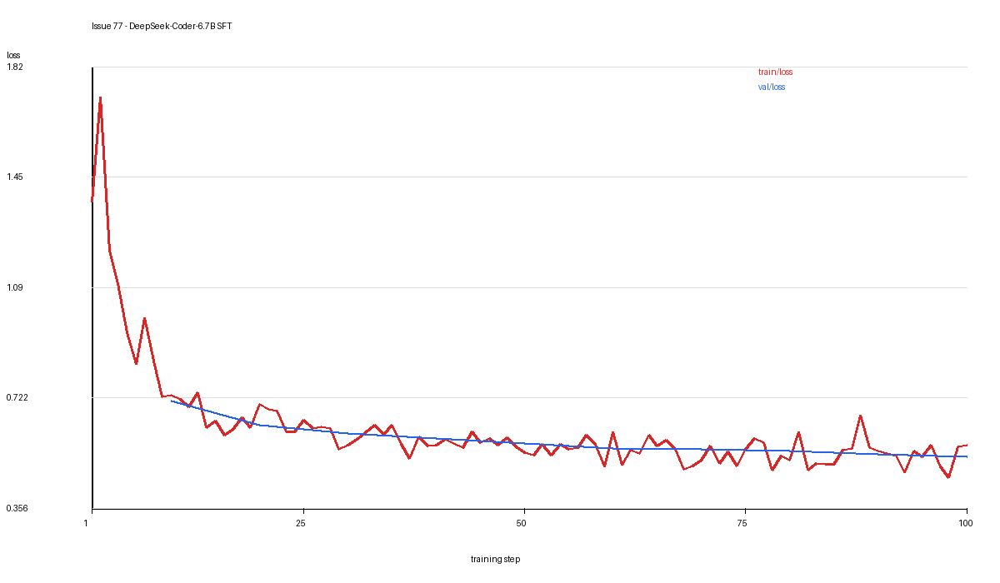
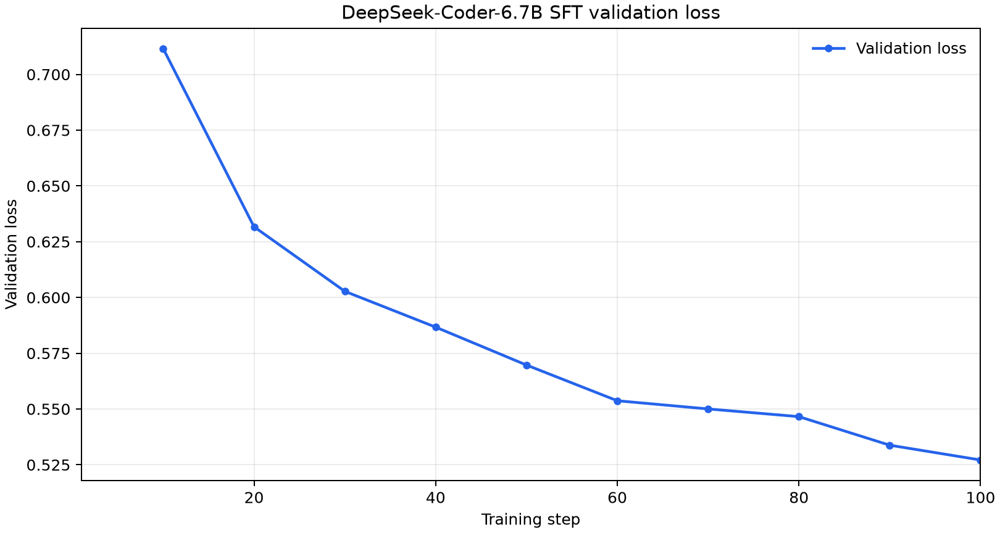

# DeepSeek-Coder-6.7B FSDP SFT Ascend Recipe

对应任务：[verl-ascend-recipe #77](https://github.com/verl-project/verl-ascend-recipe/issues/77)。

本目录提供 `deepseek-ai/deepseek-coder-6.7b-instruct` 在 Ascend NPU 上执行 FSDP SFT 的训练配置。八卡运行从初始权重完成 100 个训练 steps，训练进度用时约 5 分 27 秒。训练 loss 首末十步均值从 1.044254 降至 0.524992，验证 loss 从 0.711537 降至 0.527133，单 NPU 平均 TPS 为约 717.88 tokens/s。

## 训练链路

实现沿用任务指定的 [DeepSeek-Coder FSDP SFT 示例](https://github.com/verl-project/verl/blob/main/examples/sft/gsm8k/run_deepseek_coder_6_7b_fsdp.sh)，以单一 Bash 脚本调用 `verl.trainer.sft_trainer`：

```text
GSM8K question / answer -> messages parquet -> tokenizer / chat template
                       -> FSDP + Ulysses SP2 SFT update
                       -> 每 10 步验证 -> 最终 checkpoint
```

## 文件职责

| 文件 | 内容 |
| --- | --- |
| `run_deepseek_coder_6_7b_sft_fsdp_npu.sh` | 数据预处理、NPU 通信环境、FSDP SFT 配置和训练入口 |
| `README.md` | 环境、模型与数据、运行命令、关键配置及结果 |
| `assets/loss_curve.png` | 训练与验证 loss 曲线 |
| `assets/val_loss_curve.png` | 验证 loss 曲线 |

## 环境

| 组件 | 验证版本或配置 |
| --- | --- |
| NPU | 8 x Ascend 910B |
| CANN | 9.1.0 |
| Python | 3.12.13 |
| PyTorch / torch_npu | 2.10.0 / 2.10.0.post4 |
| transformers | 5.3.0 |
| datasets / pyarrow | 5.0.1 / 24.0.0 |
| verl | 0.10.0.dev0，FSDP SFT trainer |

Ascend 环境安装参考 [verl 昇腾安装指南](https://github.com/verl-project/verl/blob/main/docs/ascend_tutorial/zh/get_start/install_guidance.rst)。`PYTHON_BIN` 指向训练环境的 Python，`VERL_ROOT` 指向包含 `verl/trainer/sft_trainer.py` 的源码目录。

## 模型与数据

下载模型：

```bash
hf download deepseek-ai/deepseek-coder-6.7b-instruct \
  --local-dir /path/to/deepseek-coder-6.7b-instruct
```

数据使用 [openai/gsm8k](https://huggingface.co/datasets/openai/gsm8k) 的 `main` 配置。预处理脚本把 question 和 answer 转换为 user / assistant 的 `messages`，分别生成 train 和 test parquet：

```bash
mkdir -p /path/to/data/gsm8k-sft
/path/to/python /path/to/verl/examples/data_preprocess/gsm8k_multiturn_sft.py \
  --local_dir /path/to/data/gsm8k-sft
```

训练脚本默认读取 `${DATA_ROOT}/gsm8k-sft/train.parquet` 和 `test.parquet`；文件不存在时自动调用上述预处理。已有 parquet 可通过 `TRAIN_FILE`、`VAL_FILE` 指定。

## 八卡运行

```bash
PYTHON_BIN=/path/to/python \
MODEL_PATH=/path/to/deepseek-coder-6.7b-instruct \
DATA_ROOT=/path/to/data \
VERL_ROOT=/path/to/verl \
CKPTS_DIR=/path/to/checkpoints/deepseek-coder-6.7b-sft \
LOG_FILE=/path/to/logs/deepseek-coder-6.7b-sft/train.log \
NDEVICES_PER_NODE=8 \
ASCEND_RT_VISIBLE_DEVICES=0,1,2,3,4,5,6,7 \
TOTAL_TRAINING_STEPS=100 \
bash /path/to/verl-ascend-recipe/sft/deepseek-coder-6.7b/run_deepseek_coder_6_7b_sft_fsdp_npu.sh
```

脚本接受追加的 Hydra overrides，并返回训练进程的退出状态。

## 关键配置

| 参数 | 验证值 |
| --- | --- |
| 节点 / NPU | 1 / 8 |
| training engine / Ulysses SP | FSDP / 2 |
| global batch / micro batch per NPU | 64 / 1 |
| max sequence length / token cap per NPU | 1024 / 8192 |
| dynamic batching / remove padding | true / true |
| gradient checkpointing | true |
| compute dtype | BF16 |
| optimizer / learning rate | AdamW / 1e-4 |
| weight decay / grad clip | 0.01 / 1.0 |
| parameter / optimizer offload | false / false |
| messages key | `messages` |
| ignore input IDs mismatch | true |
| target steps / epoch limit | 100 / 1 |
| test frequency / save frequency | 10 / -1 |
| resume mode / logger | disable / console |

## Checkpoint 与日志

训练从初始模型开始，`trainer.resume_mode=disable`。`save_freq=-1` 关闭周期保存，SFT trainer 在最终步骤仍保存 `global_step_100` checkpoint，包含模型、优化器和训练状态。

console logger 输出训练与验证指标，`LOG_FILE` 保存框架控制台日志。训练日志：[deepseek_coder_6_7b_sft_8npu.log](https://gist.github.com/OnPathXD/673aced497043f48625c405cda02178c)。

## 指标定义

| 指标 | 计算方式 |
| --- | --- |
| 训练 loss | `train/loss`，报告逐步值及首末 10 步均值 |
| 验证 loss | `val/loss`，每 10 步记录一次 |
| 训练 token | 100 步 `train/global_tokens` 总和，包含输入与回答的非 padding token |
| 训练进度时长 | epoch 进度条最终 elapsed time，约 327 秒 |
| 聚合 TPS | 训练 token 总数 / 训练进度时长 |
| 单 NPU TPS | 聚合 TPS / 8 |

该时长包含训练、周期验证和最终 checkpoint 保存，不包含模型加载等启动准备；TPS 使用完整进度时长计算。

## 验收结果

| 指标 | 结果 |
| --- | ---: |
| 训练进度时长 / 完成步数 | 约 5 分 27 秒 / 100 |
| 进程退出状态 | 0 |
| 第 1 步 / 第 100 步训练 loss | 1.370854 / 0.564636 |
| 首 / 末 10 步训练 loss 均值 | 1.044254 / 0.524992 |
| 全程训练 loss 均值 / 范围 | 0.618323 / 0.457169 至 1.716845 |
| 第 10 步 / 第 100 步验证 loss | 0.711537 / 0.527133 |
| 训练 token 总数 | 1,877,978 |
| 平均聚合 TPS | 约 5743.05 tokens/s |
| 平均单 NPU TPS | 约 717.88 tokens/s |

训练 loss 首末窗口均值下降，验证 loss 下降，单 NPU 平均 TPS 高于 100 tokens/s。




