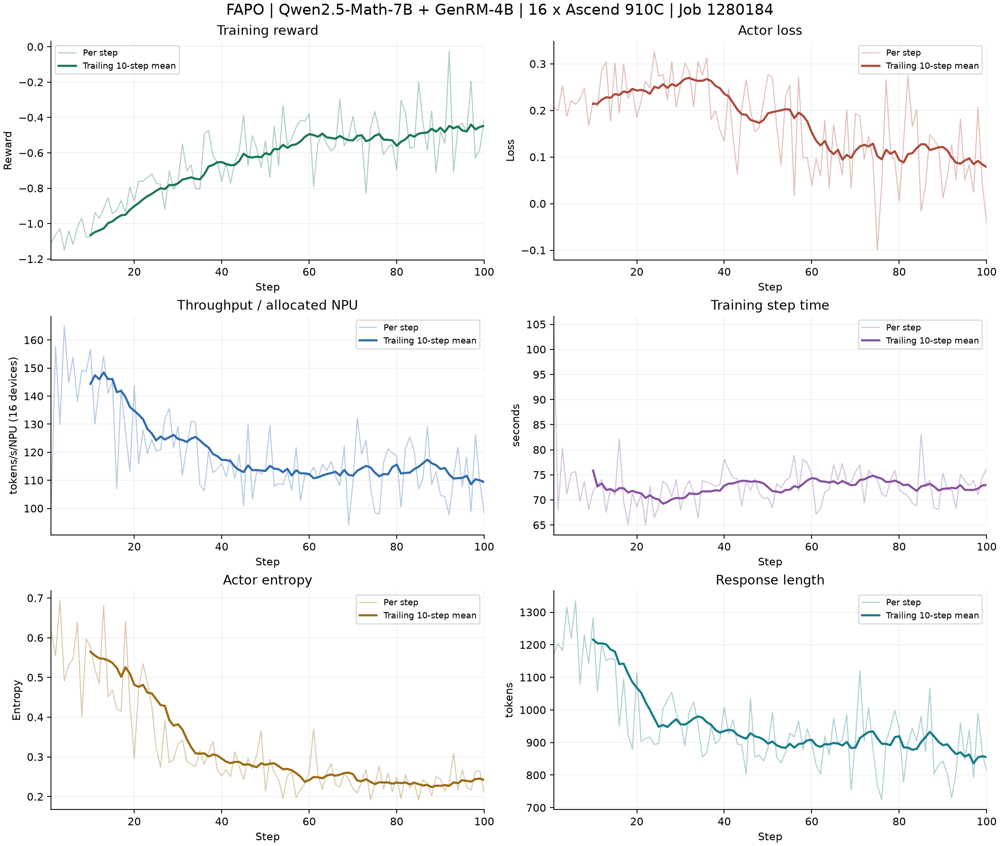

# FAPO experiment reports

Last updated: 10/20/2026

All FAPO experiment reports and exported evidence are collected in this directory.
Recipe setup and change inventory: [fapo/README.md](../../../fapo/README.md).

| Artifact | Content |
| --- | --- |
| [16-card report](FAPO_Ascend_16C_100STEP_REPORT.md) | 100 steps on Ascend 910C, job 1280184 |
| [Historical 8-card report](FAPO_910B_phase4_report.md) | Earlier Ascend 910B experiment; original full logs are not available here |
| [Original training log](logs/train_1280184.raw.log) | Complete retrieved train.log, including ANSI sequences and Ray deduplication markers |
| [Readable training log](logs/train_1280184.log) | Same log with ANSI sequences removed and carriage returns converted to newlines |
| [Exit code](logs/exit_code) | Remote process exit code: 0 |
| [Step metrics](metrics_1280184.csv) | All logged scalar metrics for steps 1 through 100 |
| [Summary](summary_1280184.json) | Aggregated metrics and original-log SHA256 |
| [Training curves](assets/training_curves.png) | Reward, loss, throughput, step time, entropy and response length |
| [Export script](export_curves.py) | Rebuilds readable log, metrics, summary and curves |

## Full-run results

| Metric | Value |
| --- | ---: |
| Steps | 100/100, no missing or conflicting step records |
| Sum of logged step times | 7290.246 s |
| Mean logged step time | 72.902 s |
| Training progress timer | 2:02:05 (includes overhead outside logged step timers) |
| Processed prompt + response tokens | 13,931,414 |
| Time-weighted throughput / allocated NPU | 119.435 tokens/s |
| Aggregate throughput, all 16 NPUs | 1910.966 tokens/s |
| Per-step normalized throughput range | 94.096 to 164.969 tokens/s |
| Mean reward, steps 1-10 | -1.065026 |
| Mean reward, steps 91-100 | -0.447369 |
| Reward change between those windows | +0.617657 |

Throughput is `sum(perf/total_num_tokens) / sum(timing_s/step) / 16`;
it includes all 12 Actor devices and 4 reward-model devices in the denominator.
It counts the trainer's prompt/response tokens, not GenRM generated tokens.
This differs from averaging each step's throughput and excludes startup,
scheduling, validation and checkpoint saving.



Faint lines show every step; bold lines show a trailing 10-step mean starting
at step 10. No missing steps are interpolated. Reward improves overall but
fluctuates. These are training metrics, not held-out evaluation results.

## Provenance and reproduction

Source: `pytorchjob-huawei-devbox-1280184-master-0-fapo-20261018T154633Z/train.log`
on the persistent experiment volume. The log was retrieved on October 20, 2026.
The job used the pre-migration implementation; moving reports and scripts
does not constitute a new hardware run. Ray suppresses some repeated worker
messages; the raw log preserves those suppression markers.

```bash
uv run --no-project --with matplotlib python \
  verl_ascend_practice/reports/fapo/export_curves.py
```

The exporter rejects missing/conflicting steps and checks the throughput
formula for every step. Validation and checkpoint saving were disabled;
no saved trained model or downstream benchmark is supplied by this run.
