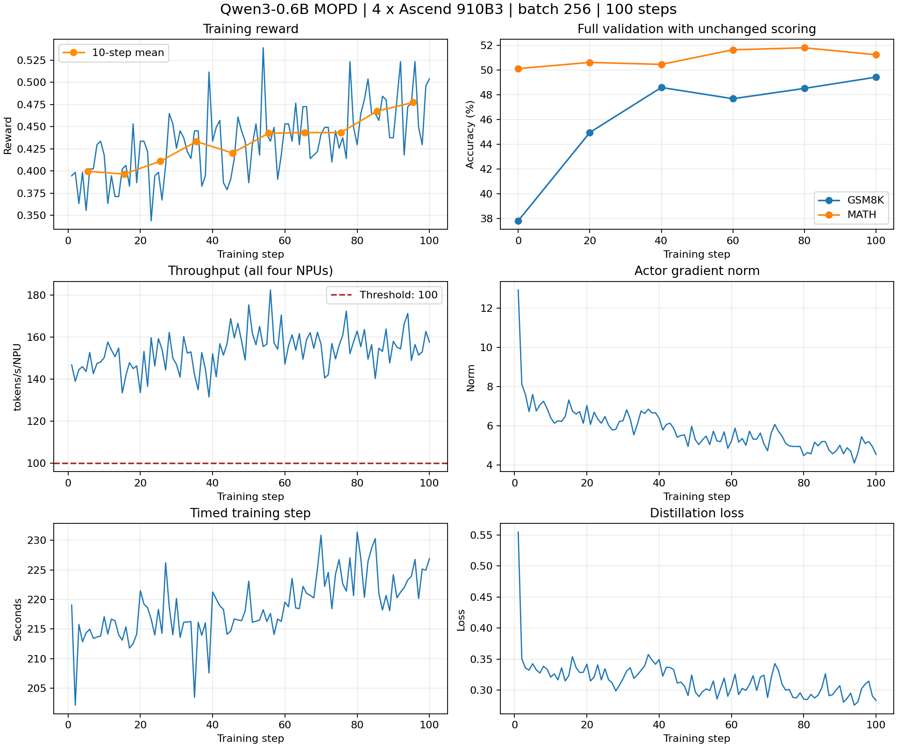

# Qwen3-0.6B 的 FSDP 多教师在线蒸馏

本实践对应 [issue #73](https://github.com/verl-project/verl-ascend-recipe/issues/73)，
学生为 Qwen3-0.6B，教师为 Qwen3-4B 和 Qwen3-8B，使用 FSDP 与 vLLM-Ascend 运行 MOPD。
固定配置在单台四张 910B3 上从初始学生权重连续训练 100 步，首末十步 reward 为
0.39961 → 0.47734，每卡训练吞吐量为 153.49 tokens/s，分母包含学生和教师共四张卡。

## 算法与适配

复用固定 verl 版本的多教师实现。学生生成后，`data_source` 将 GSM8K 样本路由到 Qwen3-4B，
将 MATH 样本路由到 Qwen3-8B。教师对学生实际生成的 token 序列计算 log-prob，不重新生成答案或套用模板。
学生和两位教师的 token ID 词表映射必须相同，本次已核验该模型组合。

`k1` 使用学生与教师 log-prob 之差，裁剪后取负并 `detach()`，作为 policy-gradient 损失的优势。
`use_task_rewards=False` 保持纯蒸馏；原 GSM8K/MATH reward 仅用于观测。
训练后端为 FSDP，学生生成和教师打分均使用 vLLM-Ascend。
NPU 适配关闭 torch.compile，使用 eager 推理、分块熵计算和 BF16 参数。

| 角色 | 模型 | 数据源 | 资源 |
| --- | --- | --- | --- |
| 学生训练与在线生成 | Qwen3-0.6B | 两套数据 | 2 张 NPU |
| GSM8K 教师 | Qwen3-4B | `openai/gsm8k` | 1 张 NPU，TP=1 |
| MATH 教师 | Qwen3-8B | `DigitalLearningGmbH/MATH-lighteval` | 1 张 NPU，TP=1 |

| 参数 | 实测值 |
| --- | --- |
| train batch / PPO mini-batch / PPO epochs | 256 / 256 / 1 |
| 每提示响应数 / 学生 rollout TP | 1 / 1 |
| prompt / response 上限 | 1024 / 2048 token |
| 动态 batch token 预算 | 24576 |
| 学习率 / 训练参数和 AdamW 状态 | 1e-6 / BF16 |
| 学生与教师推理显存比例 | 0.4 |
| 模板 | `enable_thinking=False` |
| 保存 / 验证 | 每 10 步保存，训练前及每 20 步验证 |

历史 batch128 默认配置虽完成 100 步，但 reward 从 0.33672 降到 0.25391。
固定样本对照发现格式失分和生成长度影响，单独关闭 thinking 不足以修复。
当前数据准备给 GSM8K 添加统一的简短解答和最终 `#### <number>` 格式说明，保留原问题、答案和评分。
batch256 训练从初始权重独立运行，训练前后使用相同提示、模板和评分，不借用其他试验的初始得分。
这些联合调整不能归因于某一个参数；BF16 小更新舍入风险也没有被证明是原退化的唯一原因。

## 环境与依赖

固定版本见 [REQUIRED_VERL.txt](../../../mopd/REQUIRED_VERL.txt)。本次实测软件如下。

| 组件 | 版本或提交 |
| --- | --- |
| 硬件 | 单台 4 × Ascend 910B3，64 GB/卡 |
| Python / 系统 | 3.11 / Ubuntu 22.04 |
| CANN / 驱动 | 9.0.0 / 26.0.rc1 |
| torch / torch_npu | 2.9.0 / 2.9.0.post2 |
| verl | `bc72e38edba78e778bfbd462638f9634b9140a76` |
| vLLM | 0.18.0，`bcf2be96120005e9aea171927f85055a6a5c0cf6` |
| vLLM-Ascend | 0.18.1.dev44，`a43c8cc8057f490ed1df2c6ed66253e2d7817da4` |
| transformers / peft / ray | 5.10.4 / 0.20.0 / 2.56.1 |
| NumPy / opencv-python-headless | 2.4.6 / 4.11.0.86 |

实测容器来自历史镜像
`quay.io/ascend/verl:latest-cann9.0.0-torch_npu2.9.0post2-910b-ubuntu22.04-py3.11-vllm`，
加载后的 image ID 为 `sha256:25cdc80fb496290267a07dd270023caf9a473c4167959b90b8ffe2bc3fbda27c`。
这是运行身份记录，不是当前可下载镜像的承诺；历史拉取曾返回 404。
复现时使用与上表一致的已配置环境，并核对源码和两份运行补丁。
固定旧源码的依赖声明与实测安装版本有差异，具体约束记录在 `REQUIRED_VERL.txt`：
vLLM 的 Transformers、OpenCV 和构建期 torch，以及 vLLM-Ascend 的 NumPy 声明与实测版本不一致。
这是源码包的安装约束问题，不能据此推断 MOPD 算法需要新增依赖；本 recipe 不修改这些依赖声明。

新环境的准备流程参考固定版本的[官方安装说明](https://github.com/vllm-project/vllm-ascend/blob/a43c8cc8057f490ed1df2c6ed66253e2d7817da4/docs/source/installation.md)。
本实践尚未验证该固定软件组合从零安装，使用前须解决上述约束并准备匹配的二进制依赖。
其中 `triton-ascend==3.2.1` 在 2026-10-16 查询的公开 PyPI 中不存在，本交付未提供该 wheel，也未验证其他版本可替代。
仓库的 `install_verl.sh` 只安装 verl，不能替代 CANN、NNAL 和 vLLM-Ascend 环境准备。

以下命令用于核对已有环境并应用运行补丁，不安装或替换依赖。
在 recipe 仓库根目录设置实际路径；三个源码目录须对应当前 Python 环境实际安装的代码：

```bash
set -e
export RECIPE_DIR=$(realpath mopd)
export VERL_DIR=/path/to/verl
export VLLM_DIR=/path/to/vllm
export VLLM_ASCEND_DIR=/path/to/vllm-ascend
```

核对固定源码并应用两份运行补丁。已应用时检查反向应用，不重复应用：

```bash
(
  set -e
  test "$(git -C "$VERL_DIR" rev-parse HEAD)" = bc72e38edba78e778bfbd462638f9634b9140a76
  test "$(git -C "$VLLM_DIR" rev-parse HEAD)" = bcf2be96120005e9aea171927f85055a6a5c0cf6
  test "$(git -C "$VLLM_ASCEND_DIR" rev-parse HEAD)" = a43c8cc8057f490ed1df2c6ed66253e2d7817da4
  for entry in "$VERL_DIR|$RECIPE_DIR/patches/0001-get_npu_versions-first-visible-npu-id.patch" \
               "$VLLM_ASCEND_DIR|$RECIPE_DIR/patches/vllm-ascend/0001-record-sampler-stream.patch"; do
    repo=${entry%%|*}
    patch=${entry#*|}
    if git -C "$repo" apply --reverse --check "$patch"; then
      continue
    fi
    git -C "$repo" apply --check "$patch"
    git -C "$repo" apply "$patch"
  done
)
python3 - <<'PY'
import importlib
import os
from pathlib import Path

for name, variable in (("verl", "VERL_DIR"), ("vllm", "VLLM_DIR"), ("vllm_ascend", "VLLM_ASCEND_DIR")):
    module = importlib.import_module(name)
    actual = Path(module.__file__).resolve()
    expected = Path(os.environ[variable]).resolve()
    if not actual.is_relative_to(expected):
        raise RuntimeError(f"{name} imports {actual}, expected source under {expected}")
    print(f"{name}: {actual}")
PY
python3 -m pip show torch torch-npu verl vllm vllm-ascend transformers peft ray numpy opencv-python-headless triton-ascend
npu-smi info
```

三个导入路径应指向已核对、已应用补丁的源码，实际安装版本按 `REQUIRED_VERL.txt` 逐项比对。
CANN 版本另查安装目录中的版本文件；`npu-smi` 用于核对设备和驱动。
若使用预构建安装包，须按对应项目流程安装包含运行修复的版本，再核对实际导入代码。

- 设备探测补丁从 `npu-smi info -m` 取得首个可见物理卡，保留上游已有的环境变量回退。
  上游在正确设置 `ASCEND_VISIBLE_DEVICES` 时也可处理部分设备映射；保留此补丁是为了复现实测源码，不能称其为所有环境的必需修复。
- 采样器补丁回移上游 [PR #13394](https://github.com/vllm-project/vllm-ascend/pull/13394) 的 `q.record_stream(...)`。
  `wait_stream` 保证执行顺序，`record_stream` 防止辅助流创建的张量在消费者使用完成前被分配器重用。
  历史 TP=1 对照中，原版 224621 个 token 出现 4 个越界 ID，补丁组 225828 个 token 中为 0；这不能单独解释 reward 收益。

## 模型与数据

下载 [`Qwen/Qwen3-0.6B`](https://huggingface.co/Qwen/Qwen3-0.6B)、
[`Qwen/Qwen3-4B`](https://huggingface.co/Qwen/Qwen3-4B) 和
[`Qwen/Qwen3-8B`](https://huggingface.co/Qwen/Qwen3-8B) 的权重、配置和 tokenizer。
原始数据使用固定 verl 版本内置的
[gsm8k.py](https://github.com/verl-project/verl/blob/bc72e38edba78e778bfbd462638f9634b9140a76/examples/data_preprocess/gsm8k.py) 和
[math_dataset.py](https://github.com/verl-project/verl/blob/bc72e38edba78e778bfbd462638f9634b9140a76/examples/data_preprocess/math_dataset.py) 生成。
`prepare_nonthinking_data.py` 只补充本次实测的 GSM8K 答案格式指令，不重复下载、划分或解析答案。
内置 GSM8K 脚本已有一般的 `####` 提示；额外指令明确简短解答、独立数字终行及禁止终行后的内容。
该步骤参与了完整 100 步运行，直接删除会改变实测输入。执行顺序如下：

```bash
export STUDENT_MODEL=/path/to/models/Qwen3-0.6B
export GSM8K_TEACHER_MODEL=/path/to/models/Qwen3-4B
export MATH_TEACHER_MODEL=/path/to/models/Qwen3-8B
export SOURCE_DATA_DIR=$HOME/data
export DATA_DIR=$HOME/data_mopd_nonthinking
export DEFAULT_LOCAL_DIR=/path/to/checkpoints/mopd_batch256_100

python3 "$VERL_DIR/examples/data_preprocess/gsm8k.py" --local_save_dir "$SOURCE_DATA_DIR/gsm8k"
python3 "$VERL_DIR/examples/data_preprocess/math_dataset.py" --local_save_dir "$SOURCE_DATA_DIR/math"
python3 "$RECIPE_DIR/tools/prepare_nonthinking_data.py" --source "$SOURCE_DATA_DIR" --output "$DATA_DIR"
```

输出目录须不存在，脚本只向 GSM8K 最后一个 user prompt 追加固定格式说明，不读取答案。
脚本先检查四个输入文件，在临时目录中完成处理后才创建结果目录。输入、数据解析或写入失败时清理本次产物，
修正问题后可使用原命令重试；已有输出目录或符号链接仍会被拒绝，不覆盖其中的数据。
其他字段和行序保持不变，MATH 文件逐字节复制。无需预先用 tokenizer 扫描数据，训练时由 verl 统一套用
非思考模板并按 1024 token 过滤。本轮过滤后训练 14966 条，验证 GSM8K 1319 条、MATH 4998 条。

## 运行完整 100 步

使用获准的四张 NPU。`NGPUS_PER_NODE=2` 只表示学生池，教师另占两卡，运行环境必须能访问全部四张卡。
下面假定容器已将物理卡 2、3、6、7 映射为逻辑卡 0–3；设备选择按实际映射修改。
首次训练使用新的 checkpoint 目录，中断后用同一目录重跑，`RESUME_MODE=auto` 交由 verl 恢复。

```bash
export ASCEND_RT_VISIBLE_DEVICES=0,1,2,3
export RAY_TEMP_DIR=/tmp/ray-mopd

(
  set -euo pipefail
  cd "$VERL_DIR"
  bash "$RECIPE_DIR/run_qwen3_06b_mopd_fsdp_npu.sh" --cfg job --resolve > mopd_config.yaml
  bash "$RECIPE_DIR/run_qwen3_06b_mopd_fsdp_npu.sh" 2>&1 | tee mopd_training.log
)
```

默认脚本对应上面的 batch256、双教师和非思考配置，末尾可追加 Hydra 参数。
epoch 上限默认等于目标步数，`total_training_steps=100` 控制结束，避免一个 epoch 只有 58 个 batch 时提前停止。
修改模型、数据或参数后需要单独验证。Ray 临时路径宜短，本次 Unix socket 路径上限为 107 字节。

脚本直接调用 `verl.trainer.main_ppo`；`pipefail` 保留训练失败退出码，退出码 0 本身不能证明训练完成。
核对日志中的 100 次更新、两套最终验证、checkpoint 100 的模型、优化器和数据加载器状态。
本次连续运行，没有实际恢复测试，不能把 `resume_mode=auto` 或文件存在当作恢复通过。

## 实测结果与证据

| 项目 | 结果 |
| --- | --- |
| 完成步数 | 连续 100 步，没有拼接前一个 batch128 试验 |
| 首末十步平均 reward | 0.399609375 → 0.47734375 |
| 每卡训练吞吐量 | 153.494075 tokens/s，最低单步 131.480195 |
| 数值检查 | 已记录训练指标有限，各步梯度范数非零 |
| 保存与退出 | checkpoint 10–100 每 10 步保存，退出码 0，没有 OOM 或重启 |

吞吐量按 `sum(perf/total_num_tokens) / sum(perf/time_per_step) / 4` 计算，
本次为 `13434084 / 21880.460205 / 4`。token 包含 prompt 与 response，分母包括两位教师。
这不是单步吞吐量算术平均、纯生成速度或整个作业的墙钟吞吐量。

## 本地检查的覆盖范围

数据准备已进行数据内容保持、失败后重试、已有目录和并发创建目录保护等 CPU 专项检查，
四份样例 Parquet 与整理前逐字节一致。这些检查不能证明模型训练或 NPU 安装成功。
仓库 `tests/ascend_ci_case_diff_scan/` 覆盖 CI 差异扫描工具，不能作为 MOPD 算法验证。
设备效果证据来自下文固定版本的 100 步训练，本次文档和补丁整理没有新增设备训练结果。

## 验证准确率与原始证据

| 验证步 | GSM8K | MATH |
| --- | --- | --- |
| 0 | 499/1319，37.8317% | 2505/4998，50.1200% |
| 20 | 593/1319，44.9583% | 2530/4998，50.6202% |
| 40 | 641/1319，48.5974% | 2522/4998，50.4602% |
| 60 | 629/1319，47.6876% | 2581/4998，51.6407% |
| 80 | 640/1319，48.5216% | 2589/4998，51.8007% |
| 100 | 652/1319，49.4314% | 2561/4998，51.2405% |



实测 recipe 提交为 `22d70948c954311e109684228bb91c48e9031f0c`，运行时指定 batch256 和非思考模板。
当前脚本将相同参数设为默认值；数据准备删除统计与清单生成，保留相同的训练数据变换。
完整日志和元数据保存在贡献者仓库的固定历史提交，作为外部证据引用，不随当前 recipe 重复提交：

- [完整训练日志](https://github.com/xchencehn/verl-ascend-recipe/blob/092127af723d610273d940207cce411d7252485f/mopd/results/2026-09-11-batch256/training_log.txt)保留配置、初始化、100 步更新和最终验证。
- [结果汇总](https://github.com/xchencehn/verl-ascend-recipe/blob/092127af723d610273d940207cce411d7252485f/mopd/results/2026-09-11-batch256/results.json)和[运行身份与 checkpoint 记录](https://github.com/xchencehn/verl-ascend-recipe/blob/092127af723d610273d940207cce411d7252485f/mopd/results/2026-09-11-batch256/provenance.json)支持核对实测配置与终态。
- [脱敏记录](https://github.com/xchencehn/verl-ascend-recipe/blob/092127af723d610273d940207cce411d7252485f/mopd/results/2026-09-11-batch256/log_sanitization.json)记录两处内部 IP 替换，101 个指标行保持原样。

MATH 最终准确率比第 80 步低 0.5602 个百分点，两条曲线均非单调；只有一条完整轨迹，不能声称多种子稳定。
数值检查只覆盖日志指标，未证明全部中间张量；本次没有 GPU 对照、八卡、其他模型组合或实际 checkpoint 恢复结果。
现有结果满足 issue 无 GPU 标杆时的训练指标要求；实践文档已提交到 issue，正式完成仍需 PR 合入及社区验收确认。
