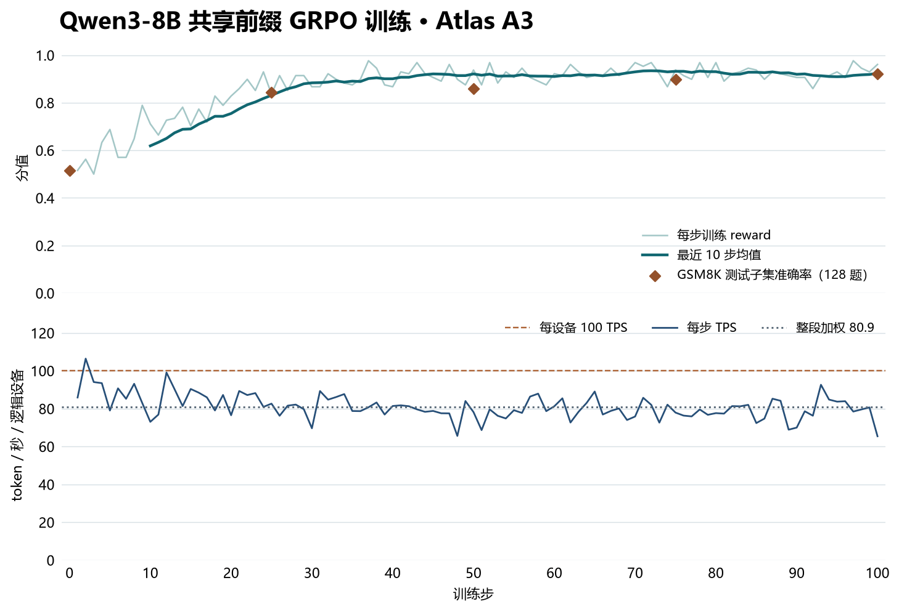

# 昇腾 A3 上的 Qwen3-8B 共享前缀训练实践

在 GSM8K 上为每条 prompt 采样两个回答后，Megatron 的 actor 和 reference 都需要为两个回答计算 log-prob。此配方在一个微批内只计算一次共同的 prompt，用注意力掩码隔离两个回答，并把各自的首 token 都映射到共享 prompt 的末位。训练采用 BF16、GRPO 以及 8 个 A3 逻辑设备，actor、reference 和 rollout 均使用 TP=2。[实现、环境和复现命令](../../../prefix_grouper/README.md)

## 两次运行的结果

| 测量项 | 100 步训练 | 10 步吞吐测试 |
| --- | ---: | ---: |
| 每步 prompt 数 | 64 | 256 |
| 有效 token 总数 | 3,761,012 | 1,693,428 |
| 累计训练时间（秒） | 5,809.09 | 1,158.31 |
| 每逻辑设备吞吐（token/s） | 80.93 | 182.75 |
| 8 个设备合计吞吐（token/s） | 647.44 | 1,461.98 |
| 首／末 10 步平均 reward | 0.61875／0.92422 | — |

100 步训练使用固定的 128 道 GSM8K 测试题和贪心解码，答对数由训练前的 66 道增至末步的 118 道。按相同 rank 口径累计，actor 更新记录的 7,522,024 个输入 token 中省去了 1,107,158 个共同前缀 token，占 14.72%。两个 TP rank 均记录同一微批。[逐步指标](https://github.com/hz-wuqifan/verl-ascend-recipe/blob/beebccc5886562113478d175efb5cce0dd2e16df/prefix_grouper/accept05/metrics.jsonl) · [微批记录](https://github.com/hz-wuqifan/verl-ascend-recipe/blob/beebccc5886562113478d175efb5cce0dd2e16df/prefix_grouper/accept05/console.log)



100 步配置满足步数和 reward 上升条件，每设备吞吐低于 100，完整核验结果为 `FAIL`。在独立的 10 步测量中，同时把全局 batch 和 PPO mini-batch 提至 256，全部步骤的每设备吞吐均超过 100，性能核验为 `PERF_PASS`。两次均按整步计时，包含采样、旧策略和 reference 打分、actor 更新及权重同步。本次没有配套的 A100 对照数据。[100 步核验](https://github.com/hz-wuqifan/verl-ascend-recipe/blob/beebccc5886562113478d175efb5cce0dd2e16df/prefix_grouper/evidence/100-step-verification.json) · [10 步核验](https://github.com/hz-wuqifan/verl-ascend-recipe/blob/beebccc5886562113478d175efb5cce0dd2e16df/prefix_grouper/evidence/performance-verification.json) · [10 步逐步指标](https://github.com/hz-wuqifan/verl-ascend-recipe/blob/beebccc5886562113478d175efb5cce0dd2e16df/prefix_grouper/perf256/metrics.jsonl)

在仓库根目录执行以下命令可复核两次运行。先下载对应提交中的逐步指标和微批日志，再运行验证脚本。100 步完整核验的预期退出码为 1，10 步性能核验的预期退出码为 0。

```bash
source_url=https://raw.githubusercontent.com/hz-wuqifan/verl-ascend-recipe/beebccc5886562113478d175efb5cce0dd2e16df/prefix_grouper
logs=$(mktemp -d)
for run in accept05 perf256; do
    mkdir -p "$logs/$run"
    for file in metrics.jsonl console.log; do
        curl -fLsS "$source_url/$run/$file" -o "$logs/$run/$file"
    done
done
python prefix_grouper/verify_metrics.py "$logs/accept05" --device A3
python prefix_grouper/verify_metrics.py "$logs/perf256" --device A3 --performance-only
```

## 正确性核对

NPU 上的 9 项测试覆盖注意力前向、梯度、共享位置及分支隔离。两层 Megatron GPTModel 将共享前缀与逐条计算对照，TP=1 联合损失的最大参数梯度相对 L2 误差为 0.00642，TP=2 的两个 rank 分别为 0.00780、0.00611。每次反向均触发两层重计算。TP=2 另在两个 rank 上完成了 154 个有效 token、两个 logits 分块的回归测试。[NPU 单测](https://github.com/hz-wuqifan/verl-ascend-recipe/blob/beebccc5886562113478d175efb5cce0dd2e16df/prefix_grouper/evidence/npu-unit.log) · [TP=1 对照](https://github.com/hz-wuqifan/verl-ascend-recipe/blob/beebccc5886562113478d175efb5cce0dd2e16df/prefix_grouper/evidence/megatron-tp1.log) · [TP=2 对照](https://github.com/hz-wuqifan/verl-ascend-recipe/blob/beebccc5886562113478d175efb5cce0dd2e16df/prefix_grouper/evidence/megatron-tp2.log)
