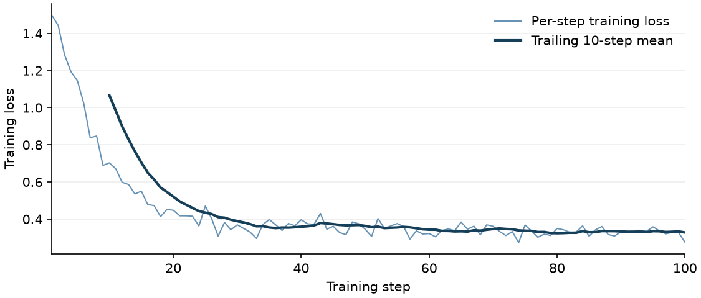

# Qwen3-8B 在昇腾 A2 上的 FSDP 监督微调

单机 8 张 Ascend 910B4 上，Qwen3-8B 开启 LoRA 和两路 Ulysses 序列并行，从初始模型连续训练 100 步。首末各 10 步的平均训练 loss 从 **1.0664 降至 0.3276**；第 11–90 步八卡合计吞吐约 **1,318 tokens/s**，折合 **164.7 tokens/s/卡**。另一次关闭 LoRA 和序列并行的全参数作业完成了两步更新、验证和保存。两次成功运行的原始日志均随报告提交。[社区任务 #74](https://github.com/verl-project/verl-ascend-recipe/issues/74)

## 算法与适配

训练入口调用 `verl.trainer.sft_trainer`，由 FSDP 在 8 个进程间分片模型。GSM8K 问题构成用户消息，参考解答构成助手消息，训练目标是在问题上下文中预测解答 token。LoRA 作业在基座模型的线性层上训练适配器，并以 `SP_SIZE=2` 将序列分到两路计算。全参数作业关闭适配器，对基座参数执行更新。

| 实测参数 | LoRA 长跑 | 全参数功能验证 |
| --- | ---: | ---: |
| 训练步数 / 全局 batch | 100 / 32 | 2 / 8 |
| 序列并行大小 | 2 | 1 |
| LoRA rank / alpha / 目标层 | 32 / 16 / `all-linear` | 关闭 |
| 每卡 micro batch / 最大序列长度 | 1 / 1,024 | 1 / 1,024 |
| 每卡动态 batch token 预算 | 2,048 | 1,024 |
| 学习率 | 1e-4 | 1e-4 |
| 最终验证样本数 | 128 | 8 |

启动脚本通过 `USE_PEFT` 和 `SP_SIZE` 分别控制两个开关，允许在命令末尾追加 Hydra 参数。适配 verl 0.9.1 时移除了模型配置中未声明的 `model.lora_dropout` 覆盖项。[训练入口](../../../sft/run_qwen3_8b_fsdp_sft_npu.sh)

## 环境与依赖

| 组件 | 实测配置 |
| --- | --- |
| 硬件 |  8 × Ascend 910B4，每卡 32 GiB |
| 系统 / Python | Ubuntu 22.04 / Python 3.12.13 |
| CANN / PyTorch / torch_npu | 9.1.0 / 2.10.0+cpu / 2.10.0.post4 |
| verl / Transformers / PEFT | 0.9.1 / 5.5.4 / 0.21.2 |
| TensorDict / NumPy | 0.10.0 / 1.26.4 |

首次运行完成训练、评估与保存，但进程退出时收到 `SIGABRT`。仅导入训练器也能复现异常。该镜像预加载系统 `libjemalloc.so.2` 后，导入检查、全参数两步验证及重新从初始权重训练的 100 步作业均以状态码 0 退出。下表与曲线只使用后两次成功作业。

```bash
set -eo pipefail
export RECIPE_DIR="$PWD"
export PATH=/usr/local/python3.12.13/bin:$PATH
source /usr/local/Ascend/ascend-toolkit/set_env.sh
source /workspace/issue74-validation/env/bin/activate
export LD_PRELOAD=/lib/aarch64-linux-gnu/libjemalloc.so.2
export OMP_NUM_THREADS=2 TOKENIZERS_PARALLELISM=false WANDB_MODE=disabled
npu-smi info
python -m pip show verl torch torch-npu transformers peft tensordict
```

## 模型与数据

实测模型目录为 `/workspace/Qwen3_8b`，含配置、tokenizer 和 5 个 safetensors 权重分片。使用 GSM8K 原始 train/test 划分，按原始行序保留题目、推导和最终答案。以下转换得到训练器读取的 `messages` 列。[模型](https://huggingface.co/Qwen/Qwen3-8B) · [GSM8K 原始数据](https://github.com/openai/grade-school-math/tree/master/grade_school_math/data)

```bash
export MODEL_PATH=/workspace/Qwen3_8b
export DATA_DIR="$PWD/gsm8k_sft"
mkdir -p "$DATA_DIR"
for split in train test; do
  curl -fL "https://raw.githubusercontent.com/openai/grade-school-math/master/grade_school_math/data/$split.jsonl" \
    -o "$DATA_DIR/$split.jsonl"
done
python - <<'PY'
import json
import os
from pathlib import Path

import pyarrow as pa
import pyarrow.parquet as pq

directory = Path(os.environ["DATA_DIR"])
for split, expected in [("train", 7473), ("test", 1319)]:
    rows = []
    for line in (directory / f"{split}.jsonl").read_text(encoding="utf-8").splitlines():
        sample = json.loads(line)
        rows.append({"messages": [
            {"role": "user", "content": sample["question"]},
            {"role": "assistant", "content": sample["answer"]},
        ]})
    assert len(rows) == expected
    pq.write_table(pa.Table.from_pylist(rows), directory / f"{split}.parquet")
PY
export TRAIN_DATA="$DATA_DIR/train.parquet" TEST_DATA="$DATA_DIR/test.parquet"
```

## 运行训练

以下两条命令分别复现实测配置。每次作业使用独立的输出目录；`trainer.resume_mode=disable` 从初始权重开始。终端启用 `pipefail` 后，通过 `tee` 保存的日志和命令退出状态可以一同核对。

```bash
export NPROC_PER_NODE=8 ASCEND_RT_VISIBLE_DEVICES=0,1,2,3,4,5,6,7
export MICRO_BATCH_SIZE_PER_GPU=1 MAX_LENGTH=1024 LR=1e-4
entry="$RECIPE_DIR/sft/run_qwen3_8b_fsdp_sft_npu.sh"
common=('trainer.logger=[console]' trainer.resume_mode=disable trainer.n_gpus_per_node=8 data.num_workers=2)

# LoRA，连续 100 步
USE_PEFT=1 SP_SIZE=2 TRAIN_BATCH_SIZE=32 LORA_RANK=32 LORA_ALPHA=16 LORA_TARGETS=all-linear \
  SAVE_PATH="$PWD/checkpoints_lora_100" bash "$entry" "${common[@]}" \
  trainer.total_training_steps=100 data.val_max_samples=128 data.max_token_len_per_gpu=2048 \
  2>&1 | tee lora_sp2_100steps.log

# 全参数，两步功能验证
USE_PEFT=0 SP_SIZE=1 TRAIN_BATCH_SIZE=8 SAVE_PATH="$PWD/checkpoints_full_2" \
  bash "$entry" "${common[@]}" trainer.total_training_steps=2 data.val_max_samples=8 \
  data.max_token_len_per_gpu=1024 'checkpoint.save_contents=[model]' \
  2>&1 | tee full_sp1_2steps.log
```

## 实测结果与证据

| 观测项 | [LoRA 完整训练日志](logs/lora_sp2_100steps.log) | [全参数完整训练日志](logs/full_sp1_2steps.log) |
| --- | ---: | ---: |
| 连续更新步数 | 100 | 2 |
| 第一步 → 最后一步训练 loss | 1.4982 → 0.2753 | 1.4145 → 0.8970 |
| 最终验证 loss | 0.3928（128 条） | 1.0729（8 条） |
| 峰值已分配 / 保留显存，GiB | 13.13 / 18.81 | 22.22 / 28.48 |
| 检查点 | 第 100 步，模型、优化器、额外状态各 8 个分片 | 第 2 步，8 个模型分片 |



曲线取自 LoRA 日志中全部 100 条 `train/loss`。下降主要发生在前 30 步；第 21–30 步均值为 0.3886，第 91–100 步均值为 0.3276。逐步核对两份日志，所有训练 loss 和梯度范数均为有限值，梯度范数均大于零。


## 验收范围

按 [issue #74](https://github.com/verl-project/verl-ascend-recipe/issues/74) 的无 GPU 标杆条件，LoRA 作业提供了 100 步 loss 下降和训练 TPS 超过 100 的证据。全参数作业验证了权重更新和保存；两次运行的 batch、验证样本数和步数不同，不能据此比较两种训练方法的精度。GSM8K 生成准确率、A100 相对性能和检查点恢复尚未实测。
