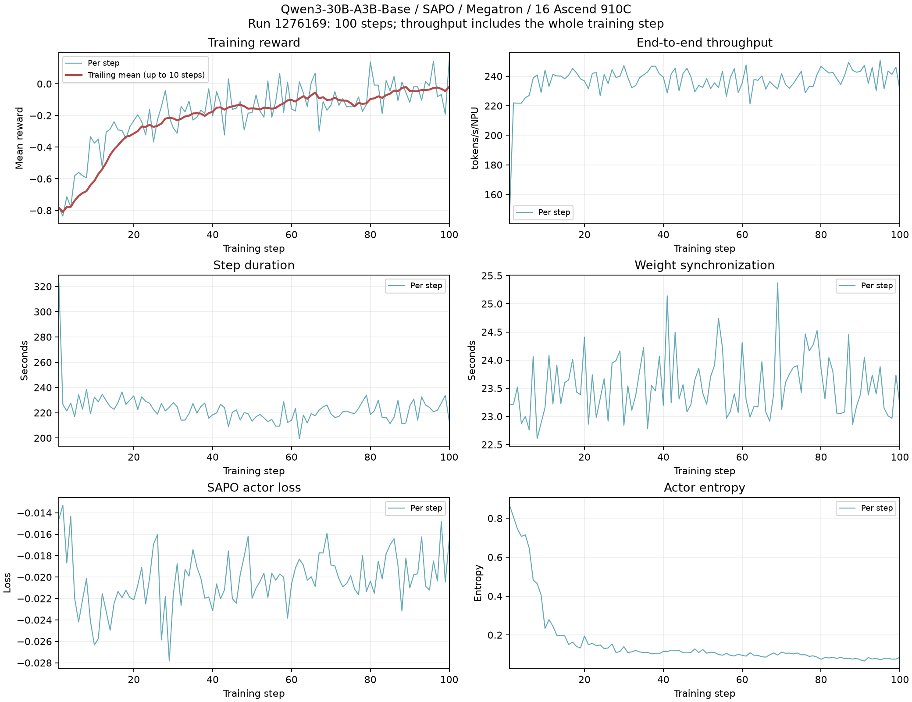

# SAPO Qwen3-30B-A3B: Ascend training evidence

Task: [issue #14](https://github.com/verl-project/verl-ascend-recipe/issues/14).
Recipe: [PR #119](https://github.com/verl-project/verl-ascend-recipe/pull/119).
Updated: 2026-10-20. All SAPO experiment reports and evidence live in this directory.

## Evidence index

| Artifact | Scope |
| --- | --- |
| [Training curves](run-1276169/training_curves.png) | All 100 measured steps; reward, throughput, timing, loss, entropy |
| [Full training log](run-1276169/train.redacted.log.gz) | Entire console training log, with internal paths/IPs redacted and ANSI colors removed; numerical values retained |
| [Per-step CSV](run-1276169/metrics.csv) | All numeric metrics for every step, including `inf/nan` |
| [Summary JSON](run-1276169/summary.json) | Recomputed aggregates, timestamps, nonfinite-metric step IDs, log SHA-256 |
| [Export script](export_metrics.py) | Rebuild the CSV, JSON and PNG from the attached log |
| [Historical 910B3 report](HISTORICAL_910B3.md) | Original PR report, kept separate; original raw logs unavailable in this update |
| [Pinned verl patches](patches/verl-bf48903d.patch) | Exact local source delta used for the 910C run |
| [TransferQueue patch](patches/transferqueue-0.1.8.patch) | Lazy import of the unused Mooncake native backend |



## Measured configuration

| Item | Run 1276169 |
| --- | --- |
| Hardware | One node, 16 Ascend 910C devices; requested 128 CPU and 1024 GiB |
| Model / weights | Qwen3-30B-A3B-Base; HF weights via legacy mbridge, no converted mcore checkpoint |
| Model/data source | ModelScope copies; HF source revision equivalence not verified |
| Data | DAPO-Math-17k-named parquet (1,791,700 rows before filtering); AIME-2024-named parquet (960 rows) |
| Algorithm | SAPO, GRPO advantage estimator; tau_pos=1.0, tau_neg=1.05, LR=1e-6 |
| KL / entropy | KL loss and KL reward disabled; entropy coefficient 0 |
| Parallelism | TP=4, PP=1, CP=1, EP=8, ETP=1; rollout TP=4 |
| Batch | 96 prompts/step, 8 responses/prompt; PPO mini batch 32, micro batch/device 4 |
| Sequence limits | Prompt 2048, response 4096, actor/log-prob token budget 8192 per device |
| Memory | Dynamic batching; actor parameter/gradient offload; optimizer CPU offload fraction 1; full uniform recomputation |
| Rollout | vLLM-Ascend 0.23.0, colocated, memory fraction 0.6, sleep enabled |
| Run limits | 100 steps; profiling off, checkpoint saving off, validation off, resume disabled |

The [launch instructions](../../../sapo/README.md) include the overrides
used for this run. This is an independent 910C run, not a rerun of the
historical 2-node 910B3 experiment with identical hardware/software.

## Runtime prerequisites

The tested verl revision is `bf48903d93e4618531d3bbae96551a889007dd8b`
with the two local changes in `patches/verl-bf48903d.patch`.
**The unpatched pin alone does not reproduce this run.**

| Component | Recorded version |
| --- | --- |
| Runtime image | `infra/vllm-ascend:v0.23.0-a3` (internal image name; not a public reproducibility guarantee) |
| Python / CANN | 3.12.13 / 9.1.0 |
| torch / torch-npu | 2.10.0+cpu / 2.10.0.post4 |
| vLLM / vLLM-Ascend | 0.23.0+empty / 0.23.0 |
| Megatron Core / MindSpeed / mbridge | 0.16.1 / 0.16.0 / 0.15.1 |
| Ray / TransferQueue | 2.48.0 / 0.1.8 |
| Transformers / NumPy | 5.5.4 / 1.26.4 |

Use an environment inheriting the image's native NPU packages; do not let
generic dependency resolution replace torch or torch-npu. This runtime has
known metadata conflicts (including generic verl NumPy requirements versus
the Ascend stack); a clean full `pip check` is not claimed.

Apply the supplied patch only to the exact pinned source, after checking it:

```bash
REPORT=/absolute/path/to/verl-ascend-recipe/verl_ascend_practice/reports/sapo
git -C /path/to/verl apply --check "$REPORT/patches/verl-bf48903d.patch"
git -C /path/to/verl apply "$REPORT/patches/verl-bf48903d.patch"
# From the site-packages directory containing transfer_queue:
patch --dry-run -p1 < "$REPORT/patches/transferqueue-0.1.8.patch"
patch -p1 < "$REPORT/patches/transferqueue-0.1.8.patch"
```

The weight-wakeup change is equivalent in purpose to the already merged
[verl #7434](https://github.com/verl-project/verl/pull/7434); it is not a new
upstream fix. Do not apply it again to versions already containing that fix.
The Mooncake import changes avoid loading an unused native library that
aborted during process shutdown in this image. They do not fix Mooncake itself.
This run used SimpleStorage and colocated weight transfer.

Both actor/ref require `vanilla_mbridge=True` for the measured legacy mbridge
path. Initialize the image's CANN environment and keep `COMPILE_CUSTOM_KERNELS=1`.
Use node-local disposable compiler/Ray caches; keep model, dataset and logs on
persistent storage.

## Modification and investigation summary

| Change | Reason | Evidence / boundary |
| --- | --- | --- |
| Resume vLLM weights even at sleep level 1 | Level 1 backs up and unmaps weights; copying before wake-up faults | Single-NPU A/B/A reproduction, then 4-step and 100-step runs; upstream #7434 |
| Lazy Mooncake engine/store imports | Eager unused native imports caused exit 134 | Imports and preflight passed; native Mooncake is still unvalidated |
| Explicit legacy mbridge overrides | `use_mbridge=True` alone selected a different backend at this pin | Actual launcher command is included in the log |
| Local compiler and Ray temporary paths | Shared-filesystem temporary cleanup failed during RoPE compilation | Small RoPE numerical check and subsequent full runs |
| Runtime dependency alignment | Preserve native NPU stack and compatible Python packages | Tested runtime above; not a universal environment installer |
| Reports moved under `verl_ascend_practice/reports/sapo` | PR reviewer requested central reports, logs and curves | This directory is the canonical report location |

## Results and timing definitions

The process finished on **2026-10-19 at 02:55:24 +08:00**, with
`training/global_step=100`, `100/100`, and `EXIT_CODE=0`.
Platform status was `Succeeded`; training pods were released.

| Metric | Measured result |
| --- | --- |
| Sum of 100 `timing_s/step` values | 22,295.75 s = 6 h 11 min 36 s |
| Training progress bar elapsed | 6 h 12 min 37 s (includes inter-step overhead) |
| Container start to process exit | 6 h 24 min 05 s |
| Submission to process exit | 6 h 27 min 16 s |
| Prompt + response tokens across all steps | 84,345,727 |
| Time-weighted normalized throughput | 236.44 tokens/s/NPU |
| Arithmetic mean of logged `perf/throughput` | 236.78 tokens/s/NPU |
| Aggregate 16-device throughput | 3,783.04 tokens/s |
| Mean step duration, excluding first | 221.95 s |
| Mean weight synchronization time | 23.54 s |
| Reward, first 25 / last 25 steps | -0.42250 / -0.04115 |
| Reward, first / final step | -0.78385 / +0.14844 |

Throughput here is `sum(batch tokens) / sum(step durations)`, divided by
16 for per-device normalization. It is not a measurement of an individual
rank's independent work or decode-only throughput. The denominator includes
generation, log probabilities, actor update and weight synchronization.
The timestamp calculation corrects the earlier issue comment: 6 h 24 min
was **container-to-exit**, not submission-to-exit.

## Limitations

- Twenty steps contain nonfinite `rollout_corr` metrics, including
  `rollout_corr/k3_kl=nan` and `rollout_corr/kl=-inf`. See the exact step IDs
  in `summary.json`; the CSV preserves these values. All logged actor losses
  and gradient norms are finite. The source and impact of the nonfinite
  diagnostics have not been isolated; exit 0 does not establish numerical
  correctness of every metric.
- Reward improves on these sampled training batches, not a held-out accuracy
  benchmark. Validation, checkpoint saving and resume were disabled. No
  downstream 5% error comparison or GPU baseline is claimed.
- The historical 910B3 result is retained for provenance, but it has no raw
  logs/curves attached here. This update supplies complete evidence for 910C.

## Rebuild the artifacts

```bash
uv venv --python 3.12 /tmp/sapo-report-env
uv pip install --python /tmp/sapo-report-env/bin/python matplotlib==3.11.2
/tmp/sapo-report-env/bin/python \
  verl_ascend_practice/reports/sapo/export_metrics.py \
  verl_ascend_practice/reports/sapo/run-1276169/train.redacted.log.gz \
  --output /tmp/sapo-report-rebuilt
```

The exporter rejects missing/duplicate steps, invalid token/timing fields,
incorrect device-normalized throughput and absent successful exit markers.
It does not hide nonfinite diagnostics.

AI assistance was used to organize the report, export logs and produce plots.
This does not assert that a human has reviewed every changed line.
